# BUSINESS RULES AND WORKFLOWS
# AKATSUKI YUI

**Version:** 1.0  
**Status:** Draft  
**Document Type:** Business Rules and Workflows  
**Project:** Akatsuki Yui  
**Last Updated:** November 2026

---

# 1. INTRODUCTION

## 1.1. Purpose

Tài liệu Business Rules and Workflows mô tả các quy tắc nghiệp vụ và luồng xử lý của hệ thống Akatsuki Yui.

Mục đích:

- Xác định các quy tắc mà hệ thống phải tuân thủ.
- Mô tả cách các nghiệp vụ hoạt động trong thực tế.
- Xác định điều kiện hợp lệ và không hợp lệ.
- Xác định trách nhiệm của từng Role trong mỗi quy trình.
- Làm cơ sở triển khai Business Logic, Database Constraints và Test Cases.

## 1.2. Scope

Tài liệu tập trung vào các nghiệp vụ:

1. Account Registration and Approval.
2. Authentication and Authorization.
3. Project Management.
4. Project Member Management.
5. Task Management.
6. Task Assignment and Dependencies.
7. Task Review Workflow.
8. Sprint Management.
9. Sprint Planning and Backlog.
10. Kanban Board.
11. Document Library.
12. Notification.
13. Dashboard and Reporting.
14. Activity and Audit Log.

## 1.3. General Business Principles

Hệ thống phải tuân thủ các nguyên tắc:

- Mọi thao tác phải được thực hiện bởi người dùng có quyền.
- Dữ liệu nghiệp vụ phải nhất quán.
- Các thay đổi quan trọng phải được lưu lịch sử.
- Không cho phép thao tác làm mất tính toàn vẹn dữ liệu.
- Không xóa lịch sử nghiệp vụ quan trọng.
- Các chỉ số báo cáo phải dựa trên dữ liệu thực tế.
- Quy trình nghiệp vụ phải được thực hiện theo đúng trạng thái và điều kiện cho phép.

---

# 2. BUSINESS ACTORS AND RESPONSIBILITIES

## 2.1. Admin

Admin quản lý toàn bộ Workspace.

Quyền và trách nhiệm:

- Quản lý tài khoản.
- Phê duyệt đăng ký.
- Quản lý Role và Permission.
- Tạo và quản lý Project.
- Theo dõi hoạt động toàn hệ thống.
- Quản lý các thiết lập được phép.

## 2.2. Instructor

Instructor có nhiệm vụ theo dõi và giám sát Project.

Quyền và trách nhiệm:

- Xem thông tin Project.
- Xem danh sách thành viên.
- Theo dõi Task.
- Xem tiến độ Project và Sprint.
- Xem báo cáo.
- Theo dõi hoạt động.

Quyền mặc định: Read-only.

## 2.3. Leader

Leader chịu trách nhiệm điều phối Project.

Quyền và trách nhiệm:

- Quản lý Project.
- Quản lý thành viên.
- Tạo và phân công Task.
- Quản lý Backlog.
- Tạo và quản lý Sprint.
- Kiểm tra Task được gửi Review.
- Approve hoặc Reject Review.
- Theo dõi tiến độ thành viên.

## 2.4. Member

Member chịu trách nhiệm thực hiện công việc được giao.

Quyền và trách nhiệm:

- Xem Task được giao.
- Cập nhật tiến độ.
- Gửi Task đến Review.
- Xem thông báo.
- Truy cập tài liệu được phép.
- Theo dõi công việc cá nhân.

---

# 3. BUSINESS RULES

## 3.1. Account Management Rules

| Rule ID | Rule Name | Description |
|---|---|---|
| BR-ACC-001 | Unique Email | Mỗi Email chỉ được sử dụng cho một tài khoản |
| BR-ACC-002 | Registration Approval | Tài khoản đăng ký mới phải được Admin phê duyệt |
| BR-ACC-003 | Pending Access Restriction | Tài khoản Pending không được truy cập chức năng nội bộ |
| BR-ACC-004 | Rejected Access Restriction | Tài khoản Rejected không được đăng nhập vào hệ thống |
| BR-ACC-005 | Suspended Access Restriction | Tài khoản Suspended không được sử dụng hệ thống |
| BR-ACC-006 | Active Account | Chỉ tài khoản Active mới được phép sử dụng chức năng theo quyền |
| BR-ACC-007 | Role Assignment | Role được gán bởi Admin theo chính sách phân quyền |
| BR-ACC-008 | Account History | Các thay đổi trạng thái và Role phải được ghi nhận |

### 3.1.1. Account Status

| Status | Meaning | Login Permission |
|---|---|---|
| Pending | Chờ phê duyệt | Not Allowed |
| Active | Đã được phê duyệt | Allowed |
| Rejected | Bị từ chối | Not Allowed |
| Suspended | Bị tạm khóa | Not Allowed |

### 3.1.2. Registration Rules

- Người dùng nhập thông tin đăng ký.
- Hệ thống kiểm tra tính hợp lệ.
- Email không được trùng.
- Password phải được kiểm tra theo chính sách bảo mật.
- Nếu hợp lệ, hệ thống tạo tài khoản Pending.
- Admin nhận được thông tin về tài khoản cần phê duyệt.
- Người dùng chỉ được sử dụng hệ thống sau khi được Approve.

**[CHƯA XÁC ĐỊNH]**
- Chính sách độ dài và độ phức tạp Password cụ thể.
- Tài khoản Rejected có được phép đăng ký lại bằng cùng Email hay không.
- Có yêu cầu xác minh Email trước khi Admin Approve hay không.
- Admin có được tạo tài khoản trực tiếp thay cho người dùng hay không.

## 3.2. Authorization Rules

| Rule ID | Rule Name | Description |
|---|---|---|
| BR-AUTHZ-001 | Role-based Access | Quyền được xác định dựa trên Role và Permission |
| BR-AUTHZ-002 | Server-side Validation | Mọi thao tác được bảo vệ phải kiểm tra quyền phía Server |
| BR-AUTHZ-003 | Admin Authority | Admin có quyền quản trị Workspace |
| BR-AUTHZ-004 | Instructor Read-only | Instructor mặc định chỉ xem dữ liệu |
| BR-AUTHZ-005 | Leader Project Management | Leader quản lý Project được phân công |
| BR-AUTHZ-006 | Member Task Access | Member thao tác trên Task theo quyền được cấp |
| BR-AUTHZ-007 | Permission History | Thay đổi Permission phải được lưu lịch sử |
| BR-AUTHZ-008 | Last Admin Protection | Không được loại bỏ quyền quản trị của Admin cuối cùng |

### 3.2.1. Default Permission Matrix

| Function | Admin | Instructor | Leader | Member |
|---|---|---|---|---|
| View Workspace | Full | View | View | View |
| Manage Accounts | Full | No | No | No |
| Approve Accounts | Full | No | No | No |
| Manage Roles | Full | No | No | No |
| Create Project | Yes | No | Yes | No |
| Update Project | Yes | No | Yes | No |
| Archive Project | Yes | No | Yes | No |
| View Project | Yes | Yes | Yes | Assigned Project |
| Manage Members | Yes | No | Yes | No |
| Create Task | Yes | No | Yes | No |
| Assign Task | Yes | No | Yes | No |
| Update Task | Yes | View | Yes | Assigned Task |
| Submit Review | Yes | View | Yes | Assigned Task |
| Approve Review | Yes | View | Yes | No |
| Reject Review | Yes | View | Yes | No |
| Manage Sprint | Yes | No | Yes | No |
| View Sprint | Yes | Yes | Yes | Assigned Project |
| Manage Documents | Yes | No | Yes | No |
| View Documents | Yes | Yes | Yes | Assigned Project |
| View Dashboard | Yes | Yes | Yes | Limited |
| View Reports | Yes | Yes | Yes | Limited |

**Lưu ý:** Đây là Permission Matrix mặc định. Quyền thực tế phải được kiểm tra theo Permission được cấu hình và phạm vi tài nguyên.

**[CHƯA XÁC ĐỊNH]**
- Member có được tạo Document Record hay chỉ được xem tài liệu?
- Member có được cập nhật Description hoặc Estimate của Task hay chỉ được cập nhật trạng thái?
- Instructor có được nhận xét hoặc gửi phản hồi về Task hay hoàn toàn Read-only?
- Admin có quyền truy cập và thay đổi mọi Task bất kể Project hay không?

## 3.3. Project Management Rules

| Rule ID | Rule Name | Description |
|---|---|---|
| BR-PROJ-001 | Project Creation Permission | Admin và Leader có quyền tạo Project |
| BR-PROJ-002 | Project Leader Required | Mỗi Project phải có một Leader |
| BR-PROJ-003 | Creator as Leader | Nếu Leader tạo Project, người tạo tự động trở thành Project Leader |
| BR-PROJ-004 | Single Active Project | Workspace chỉ có tối đa một Project Active |
| BR-PROJ-005 | Project Date Validation | Start Date không được sau End Date |
| BR-PROJ-006 | Project Lifecycle | Project có các trạng thái Created, Active và Archived |
| BR-PROJ-007 | Archived Data Retention | Project Archived phải giữ lại dữ liệu và lịch sử |
| BR-PROJ-008 | Archived Modification Restriction | Project Archived không được sử dụng cho nghiệp vụ triển khai thông thường |
| BR-PROJ-009 | Project Membership | Thành viên tham gia Project phải là tài khoản hợp lệ |
| BR-PROJ-010 | Optional Project Template | Project có thể được khởi tạo từ Project Template; Template không bắt buộc |
| BR-PROJ-011 | Optional Instructor | Project không bắt buộc phải có Instructor |
| BR-PROJ-012 | Admin Project Restore | Chỉ Admin được Restore Project Archived, subject to Active Project constraint |

**Các quy tắc bổ sung đã chốt:**
- Project Leader là bắt buộc.
- Instructor là tùy chọn; Project có thể không được gán Instructor.
- Project Template là tùy chọn; Project có thể được tạo mà không chọn Template.
- Admin được phép khôi phục Project từ `ARCHIVED` về `CREATED` hoặc `ACTIVE` theo lựa chọn hợp lệ. Việc kích hoạt lại vẫn phải tuân thủ quy tắc chỉ có tối đa một Project `ACTIVE` tại một thời điểm.

### 3.3.1. Project Lifecycle

`CREATED → ACTIVE → ARCHIVED`

| Status | Description |
|---|---|
| Created | Project đã được tạo nhưng chưa triển khai |
| Active | Project đang được thực hiện |
| Archived | Project đã được lưu trữ |

### 3.3.2. Active Project Constraint

- Chỉ được có một Project Active tại một thời điểm.
- Khi kích hoạt Project mới, hệ thống phải kiểm tra xem đã có Project Active hay chưa.
- Nếu đã có Project Active, hệ thống phải từ chối thao tác kích hoạt mới.
- Việc kiểm tra phải được thực hiện an toàn khi có nhiều yêu cầu đồng thời.

**Quyết định đã chốt:**
- Project Template là tùy chọn. Project có thể được tạo mà không cần chọn Template.
- Instructor là tùy chọn. Project có thể không có Instructor.
- Admin được phép khôi phục Project Archived. Khi khôi phục về ACTIVE, hệ thống vẫn phải bảo vệ quy tắc chỉ có tối đa một Project ACTIVE trong Workspace. Nếu đã có Project ACTIVE khác, thao tác khôi phục phải bị từ chối hoặc yêu cầu xử lý Project đang ACTIVE trước.

**[CHƯA XÁC ĐỊNH]**
- Project Created có được phép chứa Task và Sprint trước khi Active hay không?
- Khi Project Archived, các Task chưa hoàn thành được xử lý thế nào?
- Project Template gồm những thành phần nào?

## 3.4. Project Member Rules

| Rule ID | Rule Name | Description |
|---|---|---|
| BR-MEM-001 | Active Account Required | Chỉ tài khoản Active mới được thêm vào Project |
| BR-MEM-002 | Project Membership | Thành viên phải thuộc Project trước khi được giao Task trong Project |
| BR-MEM-003 | Member Removal History | Việc loại bỏ thành viên phải được ghi nhận |
| BR-MEM-004 | Task History Preservation | Loại bỏ thành viên không được xóa lịch sử Task |
| BR-MEM-005 | Assignee Reassignment | Trước khi loại bỏ thành viên, Leader phải phân công lại tất cả Task đang được giao cho thành viên đó |

**[CHƯA XÁC ĐỊNH]**
- Có cho phép một User đồng thời là Instructor và Member trong cùng Project hay không?
- Có giới hạn số lượng thành viên của một Project hay không?
- Quyết định đã chốt: Leader phải phân công lại Task trước khi loại bỏ thành viên. Không tự động chuyển Task về Leader.
- Một thành viên có được rời Project mà không cần Leader phê duyệt hay không?

**Quy tắc khi xóa thành viên khỏi Project:** Leader phải phân công lại mọi Task đang được giao cho thành viên đó trước khi xóa thành viên khỏi Project. Nếu còn Task chưa được phân công lại, thao tác xóa phải bị từ chối. Lịch sử Assignment phải được giữ lại.

## 3.5. Task Management Rules

| Rule ID | Rule Name | Description |
|---|---|---|
| BR-TASK-001 | Project Association | Mỗi Task phải thuộc một Project |
| BR-TASK-002 | Task Title Required | Task phải có Title |
| BR-TASK-003 | Deadline Required | Task bắt buộc phải có Deadline |
| BR-TASK-004 | Optional Start Date | Start Date là tùy chọn |
| BR-TASK-005 | Date Validation | Nếu có Start Date, ngày này không được sau Deadline |
| BR-TASK-006 | Multiple Assignees | Một Task có thể có nhiều Assignee |
| BR-TASK-007 | Shared Task Status | Một Task chỉ có một trạng thái chung |
| BR-TASK-008 | Task Priority | Task phải sử dụng mức Priority hợp lệ |
| BR-TASK-009 | Task History | Thay đổi quan trọng của Task phải được lưu lịch sử |
| BR-TASK-010 | Task Deadline | Task được xem là Overdue khi chưa hoàn thành và Deadline đã qua |
| BR-TASK-011 | Time Estimate | Estimate trong MVP là số giờ, tùy chọn |
| BR-TASK-012 | Dependency Completion Gate | Task không được chuyển sang DONE khi có predecessor chưa DONE |
| BR-TASK-013 | Optional Assignees at Creation | Task có thể được tạo mà chưa có Assignee; Leader có thể phân công sau thông qua nghiệp vụ Assign Task |

### 3.5.1. Task Assignment at Creation

Assignees không bắt buộc khi tạo Task. Leader có thể tạo Task chưa được phân công, ví dụ khi đưa Task vào Backlog để phân công trong quá trình lập kế hoạch. Task không có Assignee vẫn được lưu và quản lý bình thường. Khi Leader thêm Assignee sau đó, hệ thống phải lưu Assignment History và tạo Notification cho các Assignee mới được thêm. Không gửi thông báo giao Task nếu chưa có Assignee.

### 3.5.2. Task Priority

| Priority | Meaning |
|---|---|
| LOW | Mức ưu tiên thấp |
| MEDIUM | Mức ưu tiên trung bình |
| HIGH | Mức ưu tiên cao |
| CRITICAL | Mức ưu tiên nghiêm trọng/cần xử lý khẩn cấp |

### 3.5.3. Task Estimate

Estimate được sử dụng để biểu diễn khối lượng công việc dự kiến.

MVP sử dụng **Time-based Estimate**, đơn vị là giờ (hours). Estimate là giá trị số dương và không bắt buộc khi tạo Task. Story Points/Complexity-based Estimate không thuộc MVP. Việc lưu Actual Time chưa được xác định và không được suy diễn là yêu cầu.

### 3.5.4. Task Dependency

Task Dependency biểu diễn quan hệ phụ thuộc giữa các Task.

Hệ thống cần đảm bảo:

- Các Task liên quan phải thuộc cùng Project.
- Không tạo quan hệ phụ thuộc vòng lặp.
- Thông tin phụ thuộc phải được lưu và hiển thị chính xác.

**Quy tắc đã chốt:** Task tiền nhiệm phải ở trạng thái `DONE` trước khi Task phụ thuộc được chuyển sang `DONE`. Hệ thống phải từ chối thao tác hoàn thành nếu còn ít nhất một Task tiền nhiệm chưa `DONE`. Không tự suy diễn rằng Dependency chặn việc bắt đầu hoặc chuyển sang `IN PROGRESS`. Phạm vi liên Sprint và loại Dependency cụ thể vẫn cần được xác định nếu phát sinh yêu cầu triển khai.

## 3.6. Task Status Workflow Rules

### 3.6.1. Allowed Status Transitions

| Current Status | Next Status | Actor | Condition |
|---|---|---|---|
| TODO | IN PROGRESS | Assignee / Leader | Có quyền cập nhật Task |
| IN PROGRESS | REVIEW | Assignee | Task được gửi kiểm tra |
| REVIEW | DONE | Leader | Có lý do Approve |
| REVIEW | IN PROGRESS | Leader | Có lý do Reject |

### 3.6.2. Status Transition Restrictions

- Không được chuyển Task sang trạng thái không nằm trong quy trình được phép.
- Member không được tự phê duyệt Task của mình.
- Member không được tự chuyển REVIEW sang DONE.
- Leader phải nhập lý do khi Approve hoặc Reject.
- Mọi lần thay đổi trạng thái phải được ghi nhận lịch sử.

### 3.6.3. Task Review Rules

**Approve:**

1. Leader mở Task đang REVIEW.
2. Leader kiểm tra thông tin và kết quả.
3. Leader nhập lý do phê duyệt.
4. Hệ thống xác nhận quyền.
5. Task chuyển sang DONE.
6. Hệ thống lưu Review Decision.
7. Hệ thống gửi thông báo đến các Assignee.

**Reject:**

1. Leader mở Task đang REVIEW.
2. Leader kiểm tra Task.
3. Leader nhập lý do từ chối.
4. Hệ thống xác nhận quyền.
5. Task chuyển về IN PROGRESS.
6. Hệ thống lưu Review Decision.
7. Hệ thống gửi thông báo đến các Assignee.

### 3.6.4. Review Decision History

Mỗi quyết định Review phải lưu:

- Task ID.
- Reviewer ID.
- Decision.
- Reason.
- Previous Status.
- New Status.
- Created At.

## 3.7. Sprint Management Rules

| Rule ID | Rule Name | Description |
|---|---|---|
| BR-SPR-001 | Sprint Project Association | Mỗi Sprint phải thuộc một Project |
| BR-SPR-002 | Sprint Name Required | Sprint phải có tên |
| BR-SPR-003 | Sprint Goal | Sprint có mục tiêu cụ thể |
| BR-SPR-004 | Sprint Date Required | Sprint phải có Start Date và End Date |
| BR-SPR-005 | Sprint Date Validation | Start Date không được sau End Date |
| BR-SPR-006 | Sprint Status | Sprint có trạng thái quản lý riêng |
| BR-SPR-007 | Single Sprint Assignment | Một Task chỉ thuộc tối đa một Sprint tại một thời điểm |
| BR-SPR-008 | Backlog Availability | Task chưa thuộc Sprint được quản lý trong Backlog |
| BR-SPR-009 | Sprint Planning Permission | Leader quản lý Sprint Planning |
| BR-SPR-010 | Multiple Active Sprints | Một Project được phép có nhiều Sprint ACTIVE |
| BR-SPR-011 | Unfinished Sprint Task Decision | Leader quyết định cách xử lý từng Task chưa DONE khi Sprint kết thúc; mọi thay đổi assignment phải lưu lịch sử |

### 3.7.1. Sprint Status

| Status | Description |
|---|---|
| PLANNED | Sprint đã được lập kế hoạch |
| ACTIVE | Sprint đang diễn ra |
| COMPLETED | Sprint đã hoàn thành |
| CANCELLED | Sprint đã bị hủy |

### 3.7.2. Sprint Planning

Quy trình:

1. Leader mở Sprint Planning.
2. Hệ thống hiển thị danh sách Task trong Backlog.
3. Leader chọn Task phù hợp.
4. Hệ thống kiểm tra Task có thuộc Sprint khác hay không.
5. Nếu hợp lệ, Task được thêm vào Sprint.
6. Hệ thống ghi nhận Sprint Assignment History.

### 3.7.3. Sprint Task Rules

- Task phải thuộc đúng Project của Sprint.
- Task không được thuộc nhiều Sprint cùng lúc.
- Task có thể được chuyển về Backlog nếu được phép.
- Việc thay đổi Sprint Assignment phải được lưu lịch sử.

**Quy tắc đã chốt:** Một Project có thể có nhiều Sprint ở trạng thái `ACTIVE` cùng lúc. Khi Sprint kết thúc, Leader quyết định cách xử lý từng Task chưa hoàn thành (ví dụ giữ lại, chuyển về Backlog hoặc đưa sang Sprint khác); hệ thống không tự động chuyển Task. Các quy tắc về thời gian chồng lấn, thay đổi ngày Sprint đang ACTIVE, và xử lý Sprint CANCELLED vẫn cần được đặc tả nếu cần triển khai.

## 3.8. Kanban Board Rules

| Rule ID | Rule Name | Description |
|---|---|---|
| BR-KAN-001 | Status-based Columns | Kanban hiển thị Task theo trạng thái |
| BR-KAN-002 | Project Scope | Kanban có thể hiển thị toàn bộ Project |
| BR-KAN-003 | Sprint Scope | Kanban có thể lọc theo Sprint |
| BR-KAN-004 | Task Filter | Hỗ trợ lọc theo Assignee, Priority và Deadline |
| BR-KAN-005 | Permission Validation | Chỉ người có quyền mới được cập nhật Task |
| BR-KAN-006 | Workflow Compliance | Thay đổi trạng thái phải tuân thủ Task Workflow |

Kanban Board có bốn cột:

- TODO.
- IN PROGRESS.
- REVIEW.
- DONE.

Việc kéo thả Task không được bỏ qua các điều kiện nghiệp vụ.

Ví dụ: Member không thể kéo Task từ REVIEW sang DONE để tự phê duyệt.

## 3.9. Document Library Rules

| Rule ID | Rule Name | Description |
|---|---|---|
| BR-DOC-001 | Google Drive URL | Tài liệu phải có URL hợp lệ |
| BR-DOC-002 | No File Upload | Không upload file trực tiếp trong MVP |
| BR-DOC-003 | Document Category | Mỗi tài liệu phải thuộc Category hợp lệ |
| BR-DOC-004 | Project Association | Tài liệu có thể liên kết với Project |
| BR-DOC-005 | Optional Sprint Association | Tài liệu có thể liên kết với Sprint |
| BR-DOC-006 | External Permission | Quyền truy cập file phụ thuộc Google Drive |
| BR-DOC-007 | Record Deletion | Xóa Document Record không xóa file gốc |

### 3.9.1. Document Categories

| Category | Description |
|---|---|
| Project Documents | Tài liệu tổng quan Project |
| Design | Tài liệu thiết kế |
| Development | Tài liệu kỹ thuật và phát triển |
| Meeting & Reports | Biên bản họp và báo cáo |
| Other | Các tài liệu khác |

**[CHƯA XÁC ĐỊNH]**
- Một tài liệu có được liên kết với nhiều Sprint hay không?
- Có cần kiểm tra URL Google Drive có thể truy cập trước khi lưu hay không?
- Có cần hỗ trợ URL từ các dịch vụ lưu trữ khác trong tương lai không?

## 3.10. Notification Rules

| Rule ID | Event | Recipient | Notification |
|---|---|---|---|
| BR-NOTIF-001 | Account Registration | Admin | New registration |
| BR-NOTIF-002 | Account Approval | User | Account approved |
| BR-NOTIF-003 | Account Rejection | User | Account rejected |
| BR-NOTIF-004 | Task Assignment | Assignee | Task assigned |
| BR-NOTIF-005 | Task Submitted for Review | Leader | Task waiting for review |
| BR-NOTIF-006 | Review Approved | All Assignees | Task approved |
| BR-NOTIF-007 | Review Rejected | All Assignees | Task rejected |
| BR-NOTIF-008 | Project Membership Change | Relevant User | Membership changed |

**Email Notification là bắt buộc trong MVP.** Các sự kiện được quy định gửi Notification phải hỗ trợ cả In-app và Email. Email Provider cụ thể có thể được chọn trong giai đoạn cấu hình kỹ thuật, nhưng không được loại bỏ Email Notification khỏi MVP.

### 3.10.1. Notification Channels

Hệ thống bắt buộc hỗ trợ cả In-app Notification và Email Notification trong MVP.

### 3.10.2. Notification Status

| Status | Description |
|---|---|
| UNREAD | Chưa đọc |
| READ | Đã đọc |

Trạng thái gửi Email được quản lý riêng:

| Status | Description |
|---|---|
| PENDING | Đang chờ gửi |
| SENT | Gửi thành công |
| FAILED | Gửi thất bại |

### 3.10.3. Notification Rules

- Thông báo phải được gửi đến đúng người nhận.
- Không gửi thông báo đến tài khoản không còn hợp lệ.
- Mỗi thông báo phải liên kết với sự kiện hoặc đối tượng phù hợp nếu có.
- Trạng thái đọc của người dùng phải được lưu.
- Lỗi Email không được làm hỏng thao tác nghiệp vụ chính.

**[CHƯA XÁC ĐỊNH]**
- Người dùng có được tùy chỉnh loại Email Notification muốn nhận hay không?
- Có giới hạn số lần gửi lại Email thất bại không?
- Có cần thông báo khi Deadline sắp đến hoặc đã quá hạn không?
- Có cần thông báo khi Project hoặc Sprint thay đổi không?

## 3.11. Dashboard and Reporting Rules

### 3.11.1. Project Dashboard

Dashboard tổng hợp:

- Total Tasks.
- Completed Tasks.
- Overdue Tasks.
- Tasks Waiting for Review.
- In Progress Tasks.
- Project Progress.
- Member Progress.
- Recent Activities.

### 3.11.2. Task Metrics

| Metric | Definition |
|---|---|
| Total Tasks | Tổng số Task thuộc phạm vi báo cáo |
| Completed Tasks | Số Task có trạng thái DONE |
| In Progress Tasks | Số Task có trạng thái IN PROGRESS |
| Review Tasks | Số Task có trạng thái REVIEW |
| Overdue Tasks | Task chưa hoàn thành và Deadline đã qua |

### 3.11.3. Progress Calculation

Project Progress và Sprint Progress được tính theo **số lượng Task (`DONE / Total Tasks`)** (`DEC-017`).

**[CHƯA XÁC ĐỊNH]**
- Task Priority có ảnh hưởng đến trọng số Progress không?
- Task có nhiều Assignee được tính đóng góp cho từng người như thế nào?
- Task bị hủy có được tính vào tổng số Task không?

### 3.11.4. Burndown Chart

Burndown Chart thể hiện lượng công việc còn lại theo thời gian trong Sprint, được vẽ theo **Estimate Hours** (`DEC-017`). Nếu Sprint chưa có Task nào nhập Estimate, hệ thống hiển thị thông báo thiếu dữ liệu Estimate thay vì vẽ số liệu giả.

Dữ liệu cần có:

- Sprint Start Date.
- Sprint End Date.
- Task Estimate (Hours).
- Task Completion History.
- Remaining Work (Estimate Hours).

### 3.11.5. Member Contribution

Báo cáo đóng góp thành viên cần dựa trên dữ liệu khách quan.

Các thông tin có thể hiển thị:

- Task được giao.
- Task đã hoàn thành.
- Task đang thực hiện.
- Task quá hạn.
- Lịch sử Review.
- Thời gian hoàn thành Task.

Không sử dụng số lượng Task đơn thuần để kết luận thành viên nào làm việc tốt hơn.

## 3.12. Activity and Audit Rules

| Rule ID | Rule Name | Description |
|---|---|---|
| BR-AUD-001 | Important Activity Logging | Hoạt động quan trọng phải được ghi nhận |
| BR-AUD-002 | Actor Identification | Mỗi hoạt động phải xác định người thực hiện |
| BR-AUD-003 | Timestamp | Mỗi hoạt động phải có thời điểm |
| BR-AUD-004 | Change History | Thay đổi quan trọng phải lưu giá trị trước và sau |
| BR-AUD-005 | History Preservation | Không xóa lịch sử quan trọng khi xóa dữ liệu nghiệp vụ |
| BR-AUD-006 | Permission Audit | Thay đổi Role và Permission phải được ghi nhận |

---

# 4. WORKFLOW SPECIFICATIONS

## 4.1. Account Registration and Approval Workflow

### 4.1.1. Main Flow

1. Guest truy cập trang Register.
2. Guest nhập thông tin tài khoản.
3. Hệ thống kiểm tra dữ liệu.
4. Hệ thống kiểm tra Email đã tồn tại hay chưa.
5. Nếu hợp lệ, hệ thống tạo User với trạng thái Pending.
6. Hệ thống ghi nhận sự kiện đăng ký.
7. Admin nhận thông báo có tài khoản mới.
8. Admin truy cập Account Management.
9. Admin xem thông tin tài khoản.
10. Admin Approve hoặc Reject.
11. Hệ thống cập nhật trạng thái.
12. Hệ thống ghi nhận người thực hiện và thời điểm.
13. Người dùng nhận thông báo kết quả.

### 4.1.2. Workflow Diagram

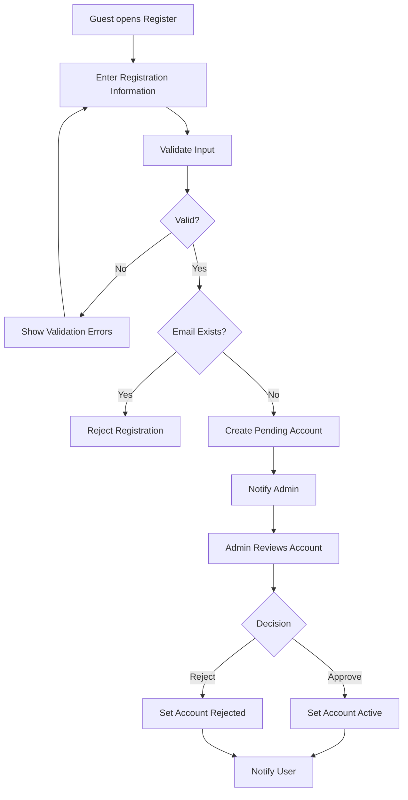

### 4.1.3. Alternative Flows

- Email đã tồn tại: hệ thống từ chối đăng ký.
- Dữ liệu không hợp lệ: hiển thị lỗi.
- Admin không có quyền: từ chối thao tác.
- Tài khoản đã được xử lý: không cho phép xử lý lại theo quyết định cũ.

## 4.2. User Login Workflow

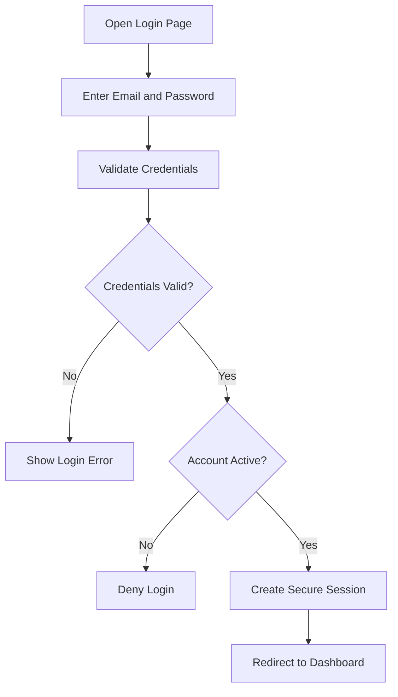

## 4.3. Project Creation Workflow

### Main Flow

1. Admin hoặc Leader truy cập Project Management.
2. Chọn Create Project.
3. Chọn Project Template nếu có.
4. Nhập thông tin Project.
5. Chọn Project Leader.
6. Chọn Instructor.
7. Chọn Members.
8. Nhập Technologies, Repository URL, Objectives và Scope.
9. Hệ thống kiểm tra dữ liệu.
10. Hệ thống kiểm tra quyền người tạo.
11. Nếu Leader tạo Project, người tạo tự động trở thành Project Leader.
12. Hệ thống tạo Project ở trạng thái Created.
13. Hệ thống lưu lịch sử tạo Project.

### Workflow Diagram

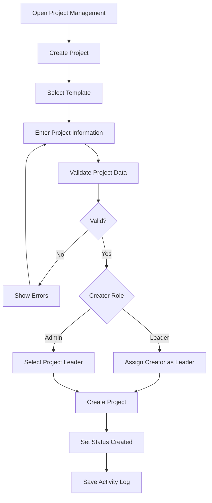

### Alternative Flows

- Người tạo không có quyền: từ chối thao tác.
- Project thiếu Leader: không cho phép tạo.
- Ngày không hợp lệ: hiển thị lỗi.
- Template không tồn tại: yêu cầu chọn lại hoặc tạo không sử dụng Template.

## 4.4. Project Activation Workflow

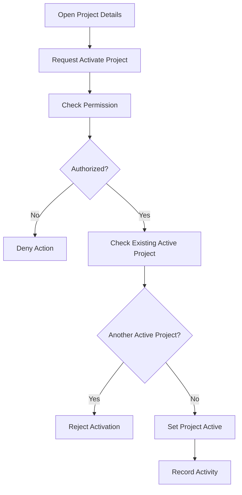

**[CHƯA XÁC ĐỊNH]** Cách xử lý Project Active hiện tại khi muốn kích hoạt Project mới.

## 4.5. Task Creation and Assignment Workflow

### Main Flow

1. Leader mở Project.
2. Chọn Task Management.
3. Chọn Create Task.
4. Nhập Task Title và Description.
5. Chọn Priority.
6. Chọn Assignee (nếu có; có thể để trống để phân công sau).
7. Nhập Start Date nếu cần.
8. Nhập Deadline.
9. Nhập Estimate nếu có.
10. Thiết lập Dependency nếu cần.
11. Chọn Sprint hoặc để Task trong Backlog.
12. Hệ thống kiểm tra dữ liệu.
13. Hệ thống tạo Task.
14. Nếu có Assignee, hệ thống ghi nhận Assignee và Assignment History.
15. Nếu có Assignee, hệ thống gửi Notification cho các Assignee được gán.

### Workflow Diagram

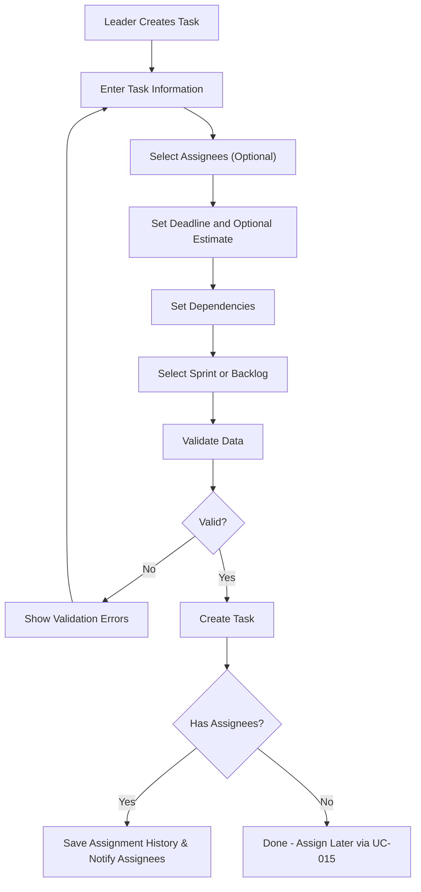

## 4.6. Task Execution Workflow

### Main Flow

1. Member mở danh sách Task được giao.
2. Member chọn Task.
3. Member xem thông tin và yêu cầu.
4. Member bắt đầu thực hiện Task.
5. Member chuyển trạng thái sang IN PROGRESS.
6. Member cập nhật Task trong quá trình thực hiện.
7. Khi hoàn thành phần việc, Member gửi Task sang REVIEW.
8. Hệ thống cập nhật trạng thái REVIEW.
9. Hệ thống lưu Task History.
10. Hệ thống thông báo cho Leader.

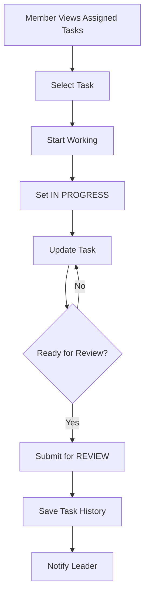

## 4.7. Task Review Workflow

### 4.7.1. Approve Flow

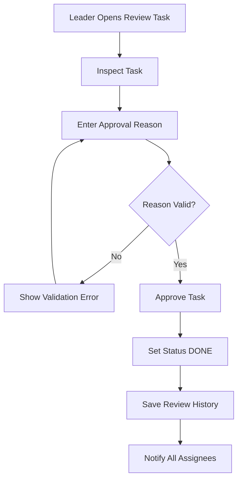

### 4.7.2. Reject Flow

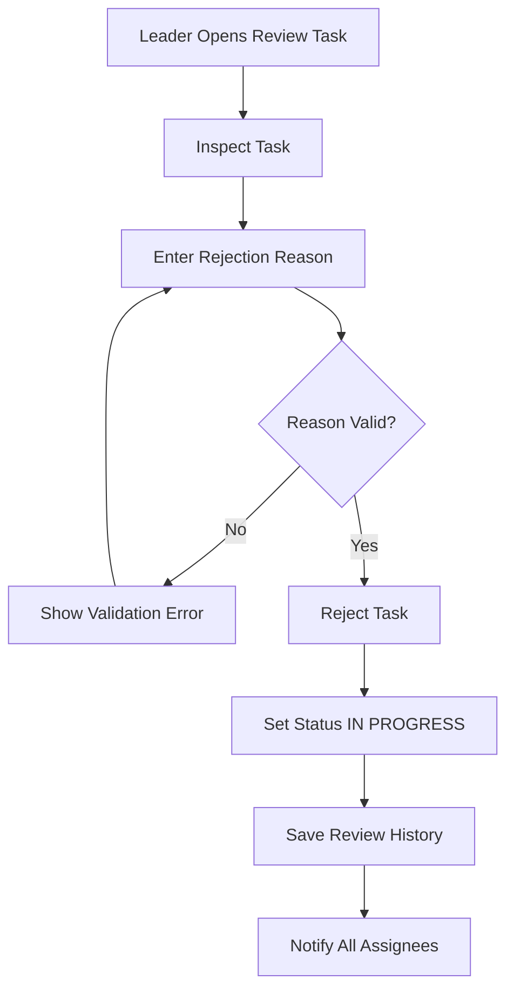

### 4.7.3. Review Conditions

- Task phải ở trạng thái REVIEW.
- Người thực hiện phải có quyền Review.
- Reason là bắt buộc.
- Reason không được chỉ chứa khoảng trắng.
- Quyết định phải được lưu vào lịch sử.
- Thông báo phải được gửi đến tất cả Assignee hiện tại của Task.

## 4.8. Sprint Creation Workflow

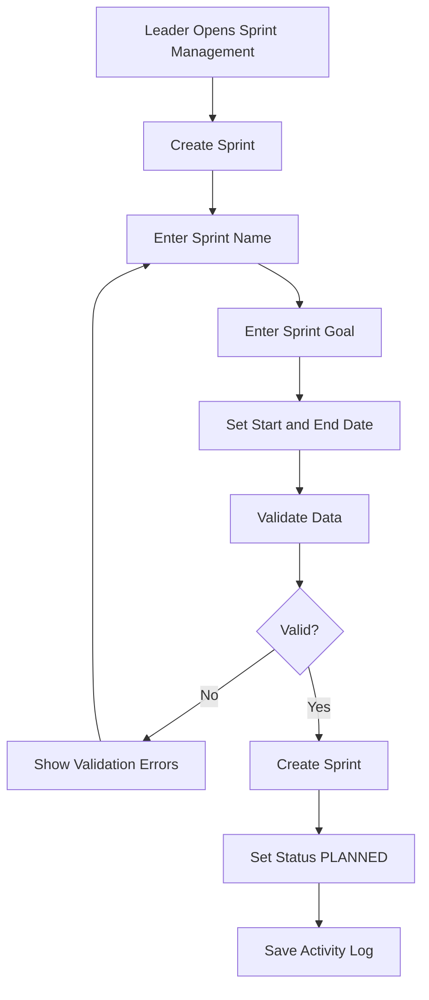

## 4.9. Sprint Planning Workflow

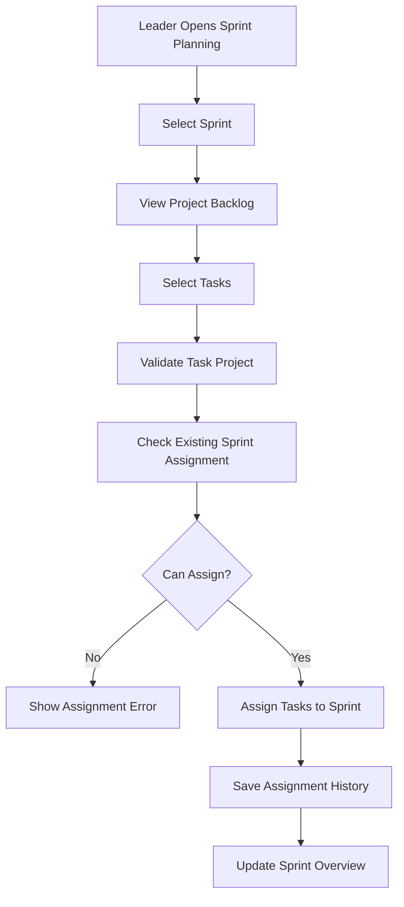

## 4.10. Document Management Workflow

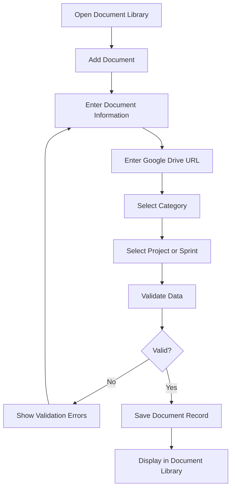

## 4.11. Notification Workflow

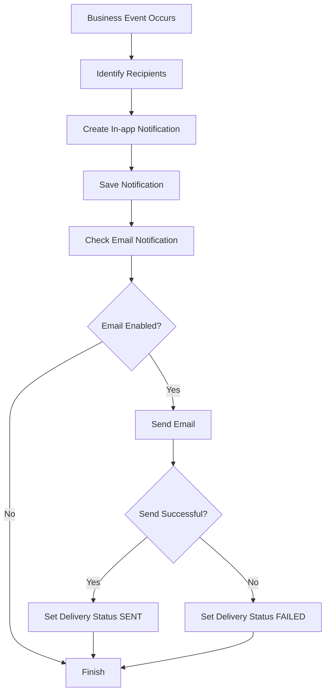

## 4.12. Project Archiving Workflow

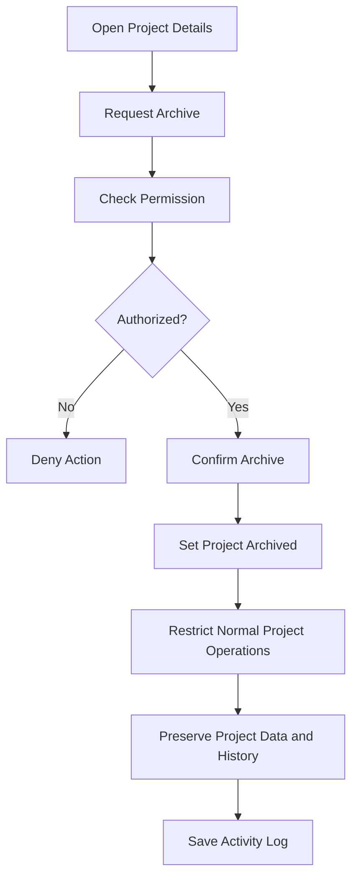

**[CHƯA XÁC ĐỊNH]** Điều kiện bắt buộc trước khi Archive Project, chẳng hạn có yêu cầu hoàn thành toàn bộ Task hay không.

---

# 5. EXCEPTION AND ERROR HANDLING RULES

## 5.1. General Rules

- Hệ thống phải hiển thị thông báo dễ hiểu khi thao tác thất bại.
- Không hiển thị Stack Trace hoặc thông tin nhạy cảm cho người dùng.
- Không lưu dữ liệu không hợp lệ.
- Không để lỗi ở một thao tác phụ làm mất dữ liệu nghiệp vụ đã được ghi nhận thành công.
- Các thao tác quan trọng phải có cơ chế đảm bảo tính nhất quán.

## 5.2. Business Exception List

| Exception ID | Scenario | Expected Handling |
|---|---|---|
| EX-001 | Email already exists | Reject registration |
| EX-002 | Account is not Active | Deny login |
| EX-003 | User lacks permission | Deny operation |
| EX-004 | Project has no Leader | Reject Project creation |
| EX-005 | Another Project is Active | Reject activation |
| EX-006 | Invalid Task Deadline | Reject Task creation/update |
| EX-007 | Invalid Status Transition | Reject status update |
| EX-008 | Review reason is empty | Reject Review decision |
| EX-009 | Task already belongs to another Sprint | Reject Sprint assignment |
| EX-010 | Task belongs to another Project | Reject Sprint assignment |
| EX-011 | Invalid Google Drive URL | Reject Document Record |
| EX-012 | Email delivery failed | Save delivery failure |
| EX-013 | Project is Archived | Restrict normal modifications |
| EX-014 | Concurrent update conflict | Reject or safely resolve conflicting update |

---

# 6. DATA AND HISTORY RULES

## 6.1. Task History

Task History phải lưu các thay đổi quan trọng:

- Task Created.
- Task Updated.
- Assignee Added.
- Assignee Removed.
- Priority Changed.
- Deadline Changed.
- Status Changed.
- Sprint Assigned.
- Sprint Removed.
- Review Approved.
- Review Rejected.

## 6.2. Project History

Project History cần lưu:

- Project Created.
- Project Updated.
- Project Activated.
- Project Archived.
- Project Leader Changed.
- Instructor Changed.
- Member Added.
- Member Removed.

## 6.3. Permission History

Lưu lại:

- Người thay đổi.
- Role hoặc Permission bị thay đổi.
- Giá trị trước thay đổi.
- Giá trị sau thay đổi.
- Thời điểm thay đổi.

## 6.4. History Integrity

- History phải được lưu cùng hoặc trong cùng giao dịch nghiệp vụ khi cần thiết.
- Không cho phép người dùng thông thường chỉnh sửa lịch sử.
- Không xóa lịch sử chỉ vì đối tượng nghiệp vụ thay đổi hoặc bị lưu trữ.
- Thông tin lịch sử phải đủ để phục vụ kiểm tra và báo cáo.

---

# 7. UNRESOLVED BUSINESS DECISIONS

Các vấn đề sau chưa có đủ thông tin để chốt quy tắc. Cần xác nhận trước khi triển khai những chức năng phụ thuộc trực tiếp vào chúng.

| ID | Topic | Question / Missing Decision | Affected Module |
|---|---|---|---|
| TBD-001 | Password Policy | Đã chốt (`DEC-013`): tối thiểu 8 ký tự (chữ hoa, chữ thường, số, ký tự đặc biệt) | Authentication |
| TBD-002 | Email Verification | Đã chốt (`DEC-014`): không yêu cầu xác minh Email trước khi Admin duyệt | Authentication |
| TBD-003 | Re-registration | Tài khoản Rejected có được đăng ký lại bằng Email cũ? | Authentication |
| TBD-004 | Admin-created Account | Admin có được tạo tài khoản trực tiếp? | User Management |
| TBD-005 | Instructor Permission | Instructor có được nhận xét hoặc phản hồi Task? | Authorization |
| TBD-006 | Member Task Editing | Đã chốt (`DEC-015`): Member chỉ sửa Status (`TODO -> IN_PROGRESS -> REVIEW`) và Reference Links / ghi chú tiến độ | Task Management |
| TBD-007 | Project Archive | Điều kiện cần có trước khi Archive Project? | Project Management |
| TBD-008 | Project Restore | Đã chốt: Admin được khôi phục Project Archived | Project Management |
| TBD-009 | Archived Task | Xử lý Task chưa hoàn thành khi Project Archived? | Project Management |
| TBD-010 | Project Template | Template gồm những cấu trúc và dữ liệu nào? | Project Management |
| TBD-011 | Member Removal | Đã chốt: Leader phải reassign mọi Task trước khi remove Member | Member Management |
| TBD-012 | Multiple Roles | Một User có thể giữ nhiều Role trong cùng Project? | Authorization |
| TBD-013 | Estimate Unit | Đã chốt: Time-based Estimate theo Hours | Task Management |
| TBD-014 | Actual Time | Có cần theo dõi thời gian thực tế? | Task Management |
| TBD-015 | Dependency Enforcement | Đã chốt: predecessor phải DONE trước khi dependent Task chuyển DONE | Task Management |
| TBD-016 | Sprint Overlap | Có cho phép các Sprint chồng lấn thời gian? | Sprint Management |
| TBD-017 | Multiple Active Sprints | Đã chốt: Cho phép nhiều Sprint ACTIVE trong một Project | Sprint Management |
| TBD-018 | Active Sprint Changes | Có cho phép thêm Task vào Sprint đang ACTIVE? | Sprint Management |
| TBD-019 | Sprint Completion | Đã chốt: Leader quyết định từng Task, không tự động chuyển | Sprint Management |
| TBD-020 | Sprint Cancellation | Task được đưa về Backlog khi Sprint bị hủy? | Sprint Management |
| TBD-021 | Progress Formula | Đã chốt (`DEC-017`): Progress tính theo Task Count (`DONE / Total`) | Dashboard |
| TBD-022 | Cancelled Tasks | Có hỗ trợ trạng thái CANCELLED cho Task? | Task Management |
| TBD-023 | Document Permission | Member có được thêm Document Record? | Document Library |
| TBD-024 | Document Validation | Có cần kiểm tra quyền truy cập Google Drive URL? | Document Library |
| TBD-025 | Notification Preferences | Người dùng có thể tùy chỉnh Email Notification? | Notification |
| TBD-026 | Deadline Reminder | Có gửi thông báo trước Deadline? | Notification |
| TBD-027 | Email Retry | Đã chốt (`DEC-016`): Resend API + retry tối đa 3 lần | Notification |
| TBD-028 | Burndown Calculation | Đã chốt (`DEC-017`): Burndown tính theo Estimate Hours (báo thiếu dữ liệu nếu chưa có Estimate) | Reporting |
| TBD-029 | Member Contribution | Các chỉ số nào được hiển thị trong báo cáo thành viên? | Reporting |
| TBD-030 | Instructor Role Scope | Instructor có quyền xem tất cả Project hay chỉ Project được phân công? | Authorization |

---

# 8. BUSINESS RULE VALIDATION CHECKLIST

Trước khi triển khai, cần kiểm tra các quy tắc sau:

- [ ] Một Workspace chỉ có tối đa một Project Active.
- [ ] Tài khoản Pending không thể đăng nhập.
- [ ] Chỉ người có quyền mới được quản lý Project.
- [ ] Project phải có Leader.
- [ ] Chỉ thành viên hợp lệ mới được gán Task.
- [ ] Task phải có Deadline.
- [ ] Task hỗ trợ nhiều Assignee.
- [ ] Task chỉ có một trạng thái chung.
- [ ] Task Status phải tuân thủ Workflow.
- [ ] Leader phải nhập Reason khi Approve hoặc Reject.
- [ ] Review Decision phải được lưu lịch sử.
- [ ] Task chỉ thuộc tối đa một Sprint.
- [ ] Sprint chỉ chứa Task thuộc cùng Project.
- [ ] Kanban không được bỏ qua quyền và Workflow.
- [ ] Document Library chỉ lưu URL trong MVP.
- [ ] Notification phải được gửi đúng người nhận.
- [ ] Email Failure không được làm hỏng nghiệp vụ chính.
- [ ] Archived Project phải giữ lại lịch sử.
- [ ] Các chỉ số báo cáo phải có định nghĩa rõ ràng.
- [ ] Các thay đổi quan trọng phải được ghi Audit Log.

---

# 9. DOCUMENT CHANGE HISTORY

| Version | Date | Description |
|---|---|---|
| 1.0 | November 2026 | Initial Business Rules and Workflows Draft |

---

**END OF BUSINESS RULES AND WORKFLOWS**

## 3.14. Confirmed Business Decisions (2026-11-14)

Các quyết định sau đã được người dùng xác nhận và là nguồn chuẩn cho các tài liệu liên quan:

| Topic | Confirmed Decision |
|---|---|
| Project Template | Optional |
| Project Instructor | Optional |
| Task Priority | LOW, MEDIUM, HIGH, CRITICAL |
| Task Estimate | Time-based, measured in hours |
| Task Dependency | A dependent Task cannot become DONE until all predecessor Tasks are DONE |
| Concurrent Active Sprints | Multiple ACTIVE Sprints per Project are allowed |
| Unfinished Sprint Tasks | Leader decides the disposition of each unfinished Task |
| Project Restore | Admin may restore an Archived Project, subject to the single-active-Project constraint |
| Member Removal | Leader must reassign all Tasks before removing the member |
| Email Notification | Required in MVP, alongside In-app Notification |
| Optional Assignees at Creation | Assignees are optional when creating a Task; may be assigned later (`DEC-011`) |
| Auth & Password Policy | Auth.js v5 (Credentials + JWT HTTP-only cookie); min 8 chars with upper/lower/digit/special; no registration email verification (`DEC-012`–`DEC-014`) |
| Member Task Editing | Assigned Member may only update Status (`TODO -> IN_PROGRESS -> REVIEW`) and Reference Links / progress notes (`DEC-015`) |
| Email Provider & Retry | Resend (Free Tier API) with max 3 retries (`DEC-016`) |
| Progress & Burndown | Progress by Task Count; Burndown by Estimate Hours (`DEC-017`) |
| User Profile | User may edit `fullName` and change Password (`DEC-018`) |

Nếu tài liệu khác có nội dung trái với bảng này, phải cập nhật tài liệu đó theo quyết định tại đây.
