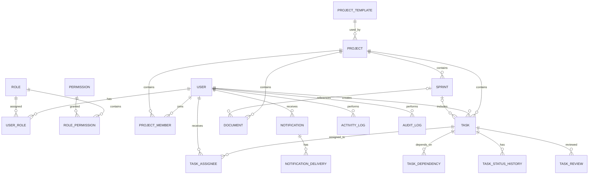

# DATABASE DESIGN DOCUMENT (DDD)

**Project:** Akatsuki Yui  
**Document Version:** 1.0  
**Status:** Draft  
**Last Updated:** 14/11/2026

---

# 1. Introduction

## 1.1. Purpose

Tài liệu Database Design Document mô tả thiết kế cơ sở dữ liệu của hệ thống Akatsuki Yui.

Tài liệu xác định:

- Các Entity chính của hệ thống.
- Thuộc tính và kiểu dữ liệu.
- Primary Key và Foreign Key.
- Mối quan hệ giữa các Entity.
- Các ràng buộc dữ liệu.
- Quy tắc lưu trữ và quản lý dữ liệu.
- Các yêu cầu về tính toàn vẹn và hiệu năng.

Đây là cơ sở để triển khai Database Schema bằng PostgreSQL và Prisma ORM.

## 1.2. Database Objectives

- Lưu trữ dữ liệu tập trung và nhất quán.
- Hỗ trợ đầy đủ các nghiệp vụ trong phạm vi MVP.
- Đảm bảo mối quan hệ giữa các dữ liệu.
- Hỗ trợ phân quyền và kiểm soát truy cập.
- Lưu lịch sử hoạt động để phục vụ truy vết và báo cáo.
- Hạn chế dữ liệu dư thừa không cần thiết.
- Có khả năng mở rộng khi hệ thống phát triển.

## 1.3. Database Technology

| Component | Proposed Technology |
|---|---|
| Database Management System | PostgreSQL |
| ORM | Prisma |
| Database Design | Entity Relationship Model |
| Schema Management | Prisma Schema |
| Migration | Prisma Migrate |
| Initial Data | Prisma Seed |

**Note:** PostgreSQL và Prisma là lựa chọn đề xuất trong Software Architecture Document, chưa phải quyết định công nghệ cuối cùng.

---

# 2. Database Design Principles

## 2.1. General Principles

- Mỗi Entity phải có Primary Key.
- Sử dụng Foreign Key để đảm bảo tính toàn vẹn tham chiếu.
- Các trường bắt buộc phải được định nghĩa NOT NULL.
- Các trường cần duy nhất phải có UNIQUE Constraint.
- Sử dụng phù hợp các loại dữ liệu của PostgreSQL.
- Không lưu trùng lặp dữ liệu nếu có thể truy xuất thông qua Relationship.
- Sử dụng Transaction cho các nghiệp vụ cập nhật nhiều dữ liệu liên quan.
- Các dữ liệu lịch sử quan trọng không được tùy tiện xóa.

## 2.2. Naming Convention

| Element | Convention | Example |
|---|---|---|
| Table | PascalCase hoặc tên nhất quán theo Prisma | User, Project, Task |
| Column | camelCase | createdAt, projectId |
| Primary Key | id | id |
| Foreign Key | entityNameId | projectId |
| Boolean | is / has prefix | isActive, isRead |
| DateTime | At suffix | createdAt, updatedAt |
| Enum | PascalCase | TaskStatus |

Tên bảng và trường phải được sử dụng nhất quán trong toàn bộ Database Schema.

## 2.3. Primary Key Strategy

Đề xuất sử dụng UUID làm Primary Key cho các Entity chính.

Ví dụ:

```text
id: UUID
```

Lợi ích:

- Hạn chế phụ thuộc vào thứ tự tạo bản ghi.
- Thuận tiện khi phát triển và tích hợp dữ liệu.
- Tránh để lộ số thứ tự bản ghi trực tiếp.

---

# 3. Entity Overview

Database được chia thành các nhóm Entity theo nghiệp vụ.

| Group | Entity | Description |
|---|---|---|
| User Management | User | Thông tin tài khoản |
| User Management | Role | Vai trò người dùng |
| User Management | Permission | Quyền hệ thống |
| User Management | UserRole | Liên kết User và Role |
| User Management | RolePermission | Liên kết Role và Permission |
| Project Management | Project | Thông tin Project |
| Project Management | ProjectTemplate | Mẫu tạo Project |
| Project Management | ProjectMember | Thành viên Project |
| Task Management | Task | Công việc |
| Task Management | TaskAssignee | Người được giao Task |
| Task Management | TaskDependency | Quan hệ phụ thuộc giữa Task |
| Task Management | TaskStatusHistory | Lịch sử trạng thái Task |
| Task Management | TaskReview | Quyết định Review |
| Sprint Management | Sprint | Thông tin Sprint |
| Document Management | Document | Thông tin liên kết tài liệu |
| Notification | Notification | Thông báo |
| Notification | NotificationDelivery | Lịch sử gửi thông báo |
| Activity Management | ActivityLog | Lịch sử hoạt động |
| Audit Management | AuditLog | Lịch sử thay đổi quan trọng |

Danh sách trên là thiết kế đề xuất ban đầu. Một số Entity có thể được điều chỉnh khi hoàn thiện Business Rules và ERD.

---

# 4. Entity Relationship Diagram (ERD)

## 4.1. High-Level ERD



**Note:**

- ERD trên thể hiện các mối quan hệ ở mức tổng quan.
- Quan hệ và Cardinality chi tiết sẽ được xác định trong từng Entity.
- Một số quan hệ có thể cần điều chỉnh khi chốt Permission Scope và nghiệp vụ cụ thể.

---

# 5. User Management

## 5.1. User

Lưu thông tin tài khoản người dùng.

| Field | Data Type | Constraint | Description |
|---|---|---|---|
| id | UUID | PK | User ID |
| email | VARCHAR(255) | UNIQUE, NOT NULL | Email đăng nhập |
| passwordHash | VARCHAR(255) | NOT NULL | Mật khẩu đã hash |
| fullName | VARCHAR(150) | NOT NULL | Họ và tên |
| avatarUrl | TEXT | NULL | URL ảnh đại diện |
| status | UserStatus | NOT NULL | Trạng thái tài khoản |
| createdAt | TIMESTAMP | NOT NULL | Ngày tạo |
| updatedAt | TIMESTAMP | NOT NULL | Ngày cập nhật |
| approvedAt | TIMESTAMP | NULL | Thời điểm phê duyệt |
| approvedById | UUID | FK, NULL | Admin phê duyệt |

**UserStatus:**

```text
PENDING
ACTIVE
REJECTED
SUSPENDED
```

**Business Rules:**

- Email phải là duy nhất.
- Tài khoản đăng ký mới mặc định có trạng thái PENDING.
- Chỉ tài khoản ACTIVE được phép sử dụng các chức năng thông thường.
- Tài khoản REJECTED hoặc SUSPENDED không được phép đăng nhập vào khu vực được bảo vệ.
- Password phải được hash trước khi lưu.
- Không lưu Password dạng văn bản thuần.

## 5.2. Role

Lưu danh sách Role của hệ thống.

| Field | Data Type | Constraint | Description |
|---|---|---|---|
| id | UUID | PK | Role ID |
| name | VARCHAR(50) | UNIQUE, NOT NULL | Tên Role |
| description | TEXT | NULL | Mô tả |
| createdAt | TIMESTAMP | NOT NULL | Ngày tạo |

**Initial Roles:**

```text
ADMIN
INSTRUCTOR
LEADER
MEMBER
```

## 5.3. Permission

Lưu danh sách quyền của hệ thống.

| Field | Data Type | Constraint | Description |
|---|---|---|---|
| id | UUID | PK | Permission ID |
| code | VARCHAR(100) | UNIQUE, NOT NULL | Permission Code |
| name | VARCHAR(100) | NOT NULL | Tên quyền |
| description | TEXT | NULL | Mô tả |
| createdAt | TIMESTAMP | NOT NULL | Ngày tạo |

Ví dụ Permission Code:

```text
USER_MANAGE
PROJECT_CREATE
PROJECT_UPDATE
PROJECT_ARCHIVE
PROJECT_VIEW
TASK_CREATE
TASK_ASSIGN
TASK_UPDATE
TASK_REVIEW
SPRINT_CREATE
SPRINT_MANAGE
DOCUMENT_MANAGE
REPORT_VIEW
```

Danh sách Permission chính thức sẽ được xác định trong Permission Matrix.

## 5.4. UserRole

Liên kết User với Role.

| Field | Data Type | Constraint | Description |
|---|---|---|---|
| id | UUID | PK | Record ID |
| userId | UUID | FK, NOT NULL | User ID |
| roleId | UUID | FK, NOT NULL | Role ID |
| createdAt | TIMESTAMP | NOT NULL | Ngày tạo |

**Constraints:**

- Một User không được có cùng một Role nhiều lần.
- Unique Constraint: `(userId, roleId)`.

## 5.5. RolePermission

Liên kết Role với Permission.

| Field | Data Type | Constraint | Description |
|---|---|---|---|
| id | UUID | PK | Record ID |
| roleId | UUID | FK, NOT NULL | Role ID |
| permissionId | UUID | FK, NOT NULL | Permission ID |
| createdAt | TIMESTAMP | NOT NULL | Ngày tạo |

**Constraints:**

- Một Role không được gán cùng một Permission nhiều lần.
- Unique Constraint: `(roleId, permissionId)`.

## 5.6. Authorization Scope

Hệ thống có thể cần phân biệt quyền toàn hệ thống và quyền trong một Project.

Phương án đề xuất:

- Role xác định vai trò chung của User.
- Permission xác định hành động được phép thực hiện.
- ProjectMember xác định User thuộc Project nào và vai trò của họ trong Project đó.

Nếu cần quyền tùy chỉnh theo từng Project, có thể mở rộng bằng ProjectRole hoặc ProjectPermission.

**Project-level Permission Schema:** [CHƯA XÁC ĐỊNH]

Không nên triển khai một hệ thống Permission quá phức tạp nếu Permission Matrix ban đầu đã đáp ứng được nhu cầu MVP.

---

# 6. Project Management

## 6.1. Project

Lưu thông tin Project.

| Field | Data Type | Constraint | Description |
|---|---|---|---|
| id | UUID | PK | Project ID |
| name | VARCHAR(200) | NOT NULL | Project Name |
| description | TEXT | NULL | Mô tả |
| objectives | TEXT | NULL | Mục tiêu |
| scope | TEXT | NULL | Phạm vi |
| startDate | DATE | NOT NULL | Ngày bắt đầu |
| endDate | DATE | NOT NULL | Ngày kết thúc |
| status | ProjectStatus | NOT NULL | Trạng thái |
| repositoryUrl | TEXT | NULL | GitHub Repository URL |
| technologies | JSONB | NULL | Danh sách công nghệ |
| templateId | UUID | FK, NULL | Project Template (optional) |
| leaderId | UUID | FK, NOT NULL | Project Leader |
| instructorId | UUID | FK, NULL | Instructor |
| createdById | UUID | FK, NOT NULL | Người tạo |
| createdAt | TIMESTAMP | NOT NULL | Ngày tạo |
| updatedAt | TIMESTAMP | NOT NULL | Ngày cập nhật |
| archivedAt | TIMESTAMP | NULL | Ngày lưu trữ |

**ProjectStatus:**

```text
CREATED
ACTIVE
ARCHIVED
```

**Business Rules:**

- Project Template là tùy chọn; `templateId` có thể NULL.
- Ngày kết thúc không được trước ngày bắt đầu.
- Project chỉ có thể được kích hoạt khi thỏa mãn các điều kiện nghiệp vụ.
- Chỉ có một Project ACTIVE tại một thời điểm.
- Project ARCHIVED vẫn giữ nguyên dữ liệu và lịch sử.
- Khi Leader tạo Project, Leader đó mặc định là Project Leader.

**Important Constraint:**

Quy tắc chỉ có một Project ACTIVE cần được bảo vệ ở Database hoặc bằng Transaction kết hợp với cơ chế kiểm soát đồng thời phù hợp. Không chỉ kiểm tra bằng giao diện.

**Constraint:** `templateId` phải nullable. Khi Project không sử dụng Template, giá trị này là `NULL`. `instructorId` cũng nullable vì Instructor không bắt buộc.

## 6.2. ProjectTemplate

Lưu mẫu tạo Project.

| Field | Data Type | Constraint | Description |
|---|---|---|---|
| id | UUID | PK | Template ID |
| name | VARCHAR(150) | NOT NULL | Template Name |
| description | TEXT | NULL | Mô tả |
| configuration | JSONB | NULL | Cấu hình mẫu |
| isActive | BOOLEAN | NOT NULL | Trạng thái sử dụng |
| createdAt | TIMESTAMP | NOT NULL | Ngày tạo |
| updatedAt | TIMESTAMP | NOT NULL | Ngày cập nhật |

Template có thể chứa cấu hình khởi tạo như:

- Các nhóm công việc mặc định.
- Cấu trúc Sprint đề xuất.
- Các thông tin Project mặc định.
- Các thiết lập ban đầu khác.

Cấu trúc `configuration` cần được xác định khi triển khai Project Template.

## 6.3. ProjectMember

Lưu thông tin thành viên thuộc Project.

| Field | Data Type | Constraint | Description |
|---|---|---|---|
| id | UUID | PK | Record ID |
| projectId | UUID | FK, NOT NULL | Project ID |
| userId | UUID | FK, NOT NULL | User ID |
| projectRole | ProjectMemberRole | NOT NULL | Vai trò trong Project |
| joinedAt | TIMESTAMP | NOT NULL | Ngày tham gia |
| leftAt | TIMESTAMP | NULL | Ngày rời Project |
| createdAt | TIMESTAMP | NOT NULL | Ngày tạo |

**ProjectMemberRole:**

```text
LEADER
MEMBER
INSTRUCTOR
```

**Constraints:**

- Một User không được có nhiều bản ghi ProjectMember đang hoạt động trong cùng một Project.
- User phải có tài khoản hợp lệ.
- Chỉ người có quyền phù hợp mới được thêm hoặc xóa thành viên.
- Việc rời Project không được làm mất lịch sử công việc trước đó.

---

# 7. Task Management

## 7.1. Task

Lưu thông tin công việc.

| Field | Data Type | Constraint | Description |
|---|---|---|---|
| id | UUID | PK | Task ID |
| projectId | UUID | FK, NOT NULL | Project ID |
| sprintId | UUID | FK, NULL | Sprint ID |
| title | VARCHAR(200) | NOT NULL | Task Title |
| description | TEXT | NULL | Task Description |
| status | TaskStatus | NOT NULL | Task Status |
| priority | TaskPriority | NOT NULL | Priority |
| startDate | DATE | NULL | Start Date |
| deadline | DATE | NOT NULL | Deadline |
| estimateValue | DECIMAL | NULL | Estimate Value |
| estimateUnit | VARCHAR(30) | NULL | Estimate Unit |
| createdById | UUID | FK, NOT NULL | Người tạo |
| createdAt | TIMESTAMP | NOT NULL | Ngày tạo |
| updatedAt | TIMESTAMP | NOT NULL | Ngày cập nhật |
| completedAt | TIMESTAMP | NULL | Ngày hoàn thành |

**TaskStatus:**

```text
TODO
IN_PROGRESS
REVIEW
DONE
```

**TaskPriority:**

```text
LOW
MEDIUM
HIGH
CRITICAL
```

**Business Rules:**

- Task thuộc về một Project.
- Task có thể thuộc Backlog hoặc một Sprint.
- Task chỉ có một trạng thái chung.
- Deadline là bắt buộc.
- Start Date là tùy chọn.
- Nếu có Start Date, Start Date không được sau Deadline.
- Task được giao cho một hoặc nhiều Assignees.
- Task chỉ được chuyển trạng thái theo Workflow hợp lệ.
- Task chuyển sang DONE phải thông qua quy trình Review.
- Task bị từ chối Review sẽ quay lại IN_PROGRESS.
- Lý do phê duyệt hoặc từ chối phải được lưu trong lịch sử.

**Estimate:**

MVP chỉ sử dụng Time-based Estimate, đơn vị giờ. `estimateValue` lưu số giờ ước tính; `estimateUnit` có thể bỏ khỏi MVP hoặc giữ dưới dạng giá trị cố định `HOURS` để tránh hỗ trợ các loại Estimate chưa được chốt. Estimate là tùy chọn. Không sử dụng Story Points trong MVP.

## 7.2. TaskAssignee

Liên kết Task với người được giao.

| Field | Data Type | Constraint | Description |
|---|---|---|---|
| id | UUID | PK | Record ID |
| taskId | UUID | FK, NOT NULL | Task ID |
| userId | UUID | FK, NOT NULL | Assignee ID |
| assignedById | UUID | FK, NOT NULL | Người phân công |
| assignedAt | TIMESTAMP | NOT NULL | Ngày phân công |
| removedAt | TIMESTAMP | NULL | Ngày gỡ phân công |

**Constraints:**

- Không tạo phân công trùng lặp cho cùng Task và User.
- Assignee phải là thành viên hợp lệ của Project.
- Lịch sử phân công cần được bảo toàn.
- Việc gỡ Assignee không xóa lịch sử công việc trước đó.

## 7.3. TaskDependency

Lưu mối quan hệ phụ thuộc giữa các Task.

| Field | Data Type | Constraint | Description |
|---|---|---|---|
| id | UUID | PK | Record ID |
| taskId | UUID | FK, NOT NULL | Task phụ thuộc |
| dependsOnTaskId | UUID | FK, NOT NULL | Task cần hoàn thành trước |
| createdAt | TIMESTAMP | NOT NULL | Ngày tạo |

Ví dụ:

```text
Task B depends on Task A
```

Nghĩa là Task B phụ thuộc vào Task A.

**Constraints:**

- Không cho phép Task phụ thuộc vào chính nó.
- Không tạo quan hệ trùng lặp.
- Hai Task phải thuộc cùng một Project.
- Cần kiểm tra vòng lặp phụ thuộc (Dependency Cycle).

Task không được chuyển sang DONE nếu tồn tại predecessor chưa DONE. Kiểm tra này phải thực hiện trong Application Service/transaction. Dependency dùng Finish-to-Start trong MVP.

## 7.4. TaskStatusHistory

Lưu lịch sử thay đổi trạng thái Task.

| Field | Data Type | Constraint | Description |
|---|---|---|---|
| id | UUID | PK | History ID |
| taskId | UUID | FK, NOT NULL | Task ID |
| oldStatus | TaskStatus | NULL | Trạng thái cũ |
| newStatus | TaskStatus | NOT NULL | Trạng thái mới |
| changedById | UUID | FK, NOT NULL | Người thay đổi |
| reason | TEXT | NULL | Lý do |
| createdAt | TIMESTAMP | NOT NULL | Thời điểm thay đổi |

**Purpose:**

- Theo dõi lịch sử Task.
- Truy xuất các lần chuyển trạng thái.
- Ghi nhận lý do Review.
- Hỗ trợ Dashboard và Reporting.

## 7.5. TaskReview

Lưu kết quả xử lý Review.

| Field | Data Type | Constraint | Description |
|---|---|---|---|
| id | UUID | PK | Review ID |
| taskId | UUID | FK, NOT NULL | Task ID |
| reviewerId | UUID | FK, NOT NULL | Người Review |
| decision | ReviewDecision | NOT NULL | Quyết định |
| reason | TEXT | NOT NULL | Lý do |
| createdAt | TIMESTAMP | NOT NULL | Thời điểm xử lý |

**ReviewDecision:**

```text
APPROVED
REJECTED
```

**Business Rules:**

- Reviewer phải có quyền xử lý Review.
- Mỗi lần xử lý Review phải lưu một bản ghi.
- Lý do xử lý là bắt buộc.
- Review mới chỉ được thực hiện khi Task đang ở trạng thái REVIEW.
- Khi APPROVED, Task chuyển sang DONE.
- Khi REJECTED, Task chuyển về IN_PROGRESS.

Việc tạo TaskReview và cập nhật TaskStatus phải nằm trong cùng một Transaction để tránh dữ liệu không nhất quán.

---

# 8. Sprint Management

## 8.1. Sprint

Lưu thông tin Sprint.

| Field | Data Type | Constraint | Description |
|---|---|---|---|
| id | UUID | PK | Sprint ID |
| projectId | UUID | FK, NOT NULL | Project ID |
| name | VARCHAR(150) | NOT NULL | Sprint Name |
| goal | TEXT | NULL | Sprint Goal |
| startDate | DATE | NOT NULL | Start Date |
| endDate | DATE | NOT NULL | End Date |
| status | SprintStatus | NOT NULL | Sprint Status |
| createdById | UUID | FK, NOT NULL | Người tạo |
| createdAt | TIMESTAMP | NOT NULL | Ngày tạo |
| updatedAt | TIMESTAMP | NOT NULL | Ngày cập nhật |

**SprintStatus:**

```text
PLANNED
ACTIVE
COMPLETED
CANCELLED
```

**Business Rules:**

- Sprint thuộc về một Project.
- Sprint có Start Date và End Date.
- End Date không được trước Start Date.
- Sprint có thể chứa nhiều Task.
- Task chỉ thuộc tối đa một Sprint tại một thời điểm.
- Sprint chỉ được quản lý bởi người có quyền phù hợp.

**Confirmed:** Một Project được phép có nhiều Sprint ACTIVE. Không tạo Unique Constraint giới hạn một ACTIVE Sprint trên Project.

## 8.2. Backlog

Backlog không nhất thiết cần một bảng riêng.

Đề xuất:

- Task có `sprintId = NULL` được xem là Task thuộc Backlog.
- Task có `sprintId` tương ứng được xem là Task thuộc Sprint đó.

Cách thiết kế này giảm số lượng Entity và tránh lưu trữ dữ liệu Backlog trùng lặp.

---

# 9. Document Management

## 9.1. Document

Lưu thông tin tài liệu được quản lý trong hệ thống.

| Field | Data Type | Constraint | Description |
|---|---|---|---|
| id | UUID | PK | Document ID |
| projectId | UUID | FK, NOT NULL | Project ID |
| sprintId | UUID | FK, NULL | Sprint ID |
| name | VARCHAR(200) | NOT NULL | Document Name |
| description | TEXT | NULL | Mô tả |
| url | TEXT | NOT NULL | Google Drive URL |
| category | DocumentCategory | NOT NULL | Document Category |
| createdById | UUID | FK, NOT NULL | Người tạo |
| createdAt | TIMESTAMP | NOT NULL | Ngày tạo |
| updatedAt | TIMESTAMP | NOT NULL | Ngày cập nhật |

**DocumentCategory:**

```text
PROJECT_DOCUMENTS
DESIGN
DEVELOPMENT
MEETING_REPORTS
OTHER
```

**Business Rules:**

- Document phải thuộc về một Project.
- Document có thể liên kết với một Sprint.
- URL phải có định dạng hợp lệ.
- Hệ thống chỉ lưu URL, không lưu file.
- Chỉ người có quyền phù hợp mới được quản lý Document.

---

# 10. Notification Management

## 10.1. Notification

Lưu thông báo gửi đến người dùng.

| Field | Data Type | Constraint | Description |
|---|---|---|---|
| id | UUID | PK | Notification ID |
| userId | UUID | FK, NOT NULL | Người nhận |
| type | NotificationType | NOT NULL | Loại thông báo |
| title | VARCHAR(200) | NOT NULL | Tiêu đề |
| message | TEXT | NOT NULL | Nội dung |
| referenceType | VARCHAR(50) | NULL | Loại tài nguyên liên quan |
| referenceId | UUID | NULL | ID tài nguyên liên quan |
| isRead | BOOLEAN | NOT NULL | Trạng thái đã đọc |
| readAt | TIMESTAMP | NULL | Thời điểm đọc |
| createdAt | TIMESTAMP | NOT NULL | Thời điểm tạo |

**NotificationType:**

```text
TASK_ASSIGNED
TASK_SUBMITTED_FOR_REVIEW
TASK_REVIEW_APPROVED
TASK_REVIEW_REJECTED
ACCOUNT_APPROVED
ACCOUNT_REJECTED
SYSTEM
```

Danh sách NotificationType có thể được mở rộng theo nghiệp vụ.

## 10.2. NotificationDelivery

Lưu lịch sử gửi thông báo qua các kênh.

| Field | Data Type | Constraint | Description |
|---|---|---|---|
| id | UUID | PK | Delivery ID |
| notificationId | UUID | FK, NOT NULL | Notification ID |
| channel | NotificationChannel | NOT NULL | Kênh gửi |
| status | DeliveryStatus | NOT NULL | Trạng thái gửi |
| retryCount | INTEGER | NOT NULL DEFAULT 0 | Số lần đã thử gửi lại (tối đa 3 theo `DEC-016`) |
| sentAt | TIMESTAMP | NULL | Thời điểm gửi |
| errorMessage | TEXT | NULL | Thông tin lỗi |
| createdAt | TIMESTAMP | NOT NULL | Ngày tạo |

**NotificationChannel:**

```text
IN_APP
EMAIL
```

**DeliveryStatus:**

```text
PENDING
SENT
FAILED
```

**Note:**

- In-app Notification được lưu trực tiếp trong Notification.
- NotificationDelivery dùng để theo dõi việc gửi qua từng kênh.
- Không nên tạo nhiều Notification giống nhau khi thực hiện Retry gửi Email.

---

# 11. Activity & Audit Management

## 11.1. ActivityLog

Lưu các hoạt động của người dùng trong hệ thống.

| Field | Data Type | Constraint | Description |
|---|---|---|---|
| id | UUID | PK | Activity ID |
| userId | UUID | FK, NULL | Người thực hiện |
| action | VARCHAR(100) | NOT NULL | Hành động |
| entityType | VARCHAR(100) | NOT NULL | Loại Entity |
| entityId | UUID | NULL | Entity ID |
| description | TEXT | NULL | Mô tả |
| metadata | JSONB | NULL | Dữ liệu bổ sung |
| createdAt | TIMESTAMP | NOT NULL | Thời điểm |

Ví dụ Activity:

```text
PROJECT_CREATED
TASK_CREATED
TASK_ASSIGNED
TASK_STATUS_CHANGED
SPRINT_CREATED
DOCUMENT_ADDED
```

ActivityLog phục vụ:

- Recent Activity.
- Theo dõi hoạt động Project.
- Dashboard.
- Báo cáo đóng góp của thành viên.

## 11.2. AuditLog

Lưu các thay đổi quan trọng cần truy vết.

| Field | Data Type | Constraint | Description |
|---|---|---|---|
| id | UUID | PK | Audit ID |
| actorId | UUID | FK, NULL | Người thực hiện |
| action | VARCHAR(100) | NOT NULL | Hành động |
| entityType | VARCHAR(100) | NOT NULL | Loại Entity |
| entityId | UUID | NULL | Entity ID |
| oldValue | JSONB | NULL | Giá trị trước |
| newValue | JSONB | NULL | Giá trị sau |
| createdAt | TIMESTAMP | NOT NULL | Thời điểm |

Các hoạt động cần Audit:

- Thay đổi Role.
- Thay đổi Permission.
- Phê duyệt hoặc từ chối tài khoản.
- Thay đổi trạng thái Project.
- Thay đổi các thiết lập quan trọng.

**Note:** Không ghi Password, Session Token hoặc Secret vào AuditLog.

ActivityLog và AuditLog có mục đích khác nhau. Không nhất thiết phải ghi mọi hoạt động thông thường vào cả hai bảng.

---

# 12. Enum Definitions

Các Enum dự kiến sử dụng:

| Enum | Values |
|---|---|
| UserStatus | PENDING, ACTIVE, REJECTED, SUSPENDED |
| ProjectStatus | CREATED, ACTIVE, ARCHIVED |
| ProjectMemberRole | LEADER, MEMBER, INSTRUCTOR |
| TaskStatus | TODO, IN_PROGRESS, REVIEW, DONE |
| TaskPriority | LOW, MEDIUM, HIGH, CRITICAL |
| ReviewDecision | APPROVED, REJECTED |
| SprintStatus | PLANNED, ACTIVE, COMPLETED, CANCELLED |
| DocumentCategory | PROJECT_DOCUMENTS, DESIGN, DEVELOPMENT, MEETING_REPORTS, OTHER |
| NotificationChannel | IN_APP, EMAIL |
| DeliveryStatus | PENDING, SENT, FAILED |

Các Enum cần được đồng bộ giữa Database Schema, Application Layer và Validation Layer.

---

# 13. Relationships & Cardinality

| Entity A | Relationship | Entity B | Description |
|---|---|---|---|
| User | Many-to-Many | Role | Một User có thể có nhiều Role |
| Role | Many-to-Many | Permission | Một Role có nhiều Permission |
| User | One-to-Many | ProjectMember | Một User tham gia nhiều Project |
| Project | One-to-Many | ProjectMember | Một Project có nhiều thành viên |
| ProjectTemplate | One-to-Many | Project | Một Template được nhiều Project sử dụng |
| Project | One-to-Many | Task | Một Project có nhiều Task |
| User | One-to-Many | Task | Một User có thể tạo nhiều Task |
| Task | Many-to-Many | User | Task có nhiều Assignees |
| Task | Many-to-Many | Task | Task có thể phụ thuộc Task khác |
| Task | One-to-Many | TaskStatusHistory | Một Task có nhiều bản ghi lịch sử |
| Task | One-to-Many | TaskReview | Một Task có nhiều lần Review |
| Project | One-to-Many | Sprint | Một Project có nhiều Sprint |
| Sprint | One-to-Many | Task | Một Sprint có nhiều Task |
| Project | One-to-Many | Document | Một Project có nhiều Document |
| Sprint | One-to-Many | Document | Một Sprint có thể liên kết nhiều Document |
| User | One-to-Many | Notification | Một User nhận nhiều Notification |
| Notification | One-to-Many | NotificationDelivery | Một Notification có thể có nhiều lần gửi |
| User | One-to-Many | ActivityLog | Một User có nhiều Activity |
| User | One-to-Many | AuditLog | Một User có nhiều Audit Record |

---

# 14. Database Constraints

## 14.1. Unique Constraints

Các trường hoặc tổ hợp trường cần đảm bảo duy nhất:

| Entity | Unique Field |
|---|---|
| User | email |
| Role | name |
| Permission | code |
| UserRole | userId + roleId |
| RolePermission | roleId + permissionId |
| ProjectMember | projectId + userId (đối với thành viên đang hoạt động) |
| TaskAssignee | taskId + userId (đối với phân công đang hoạt động) |
| TaskDependency | taskId + dependsOnTaskId |

## 14.2. Check Constraints

Các điều kiện cần kiểm tra ở Database:

- Project endDate không được trước startDate.
- Sprint endDate không được trước startDate.
- Task deadline không được trước startDate nếu startDate tồn tại.
- Estimate Value không được âm.
- Task không được phụ thuộc vào chính nó.

## 14.3. Referential Integrity

- Không để Foreign Key tham chiếu đến bản ghi không tồn tại.
- Không xóa User nếu dữ liệu lịch sử vẫn cần tham chiếu đến User đó.
- Không xóa Project nếu còn dữ liệu nghiệp vụ cần bảo toàn.
- Không xóa Task nếu còn lịch sử hoặc dữ liệu Review cần truy xuất.
- Việc xóa thành viên khỏi Project không được làm mất lịch sử phân công.

## 14.4. Delete Strategy

Đề xuất:

| Data | Delete Strategy |
|---|---|
| User | Soft Delete hoặc Suspend |
| Project | Archive |
| Task | Hạn chế xóa sau khi tạo |
| Sprint | Hạn chế xóa nếu đã có Task |
| Document | Có thể xóa Record theo quyền |
| Notification | Có thể xóa theo chính sách |
| ActivityLog | Không xóa tùy tiện |
| AuditLog | Không xóa tùy tiện |

Soft Delete có thể được áp dụng cho các Entity cần giữ lại lịch sử.

Các Entity nào thực sự cần trường `deletedAt`: **[CHƯA XÁC ĐỊNH]**.

---

# 15. Indexing Strategy

Các Index dự kiến:

| Entity | Field | Purpose |
|---|---|---|
| User | email | Login và tìm kiếm User |
| User | status | Lọc trạng thái tài khoản |
| Project | status | Lọc Project |
| ProjectMember | projectId | Lấy thành viên Project |
| ProjectMember | userId | Tìm Project theo User |
| Task | projectId | Lấy Task theo Project |
| Task | sprintId | Lấy Task theo Sprint |
| Task | status | Lọc theo trạng thái |
| Task | deadline | Tìm Task quá hạn |
| TaskAssignee | userId | Lấy Task được giao |
| TaskStatusHistory | taskId, createdAt | Truy vấn lịch sử Task |
| Sprint | projectId | Lấy Sprint theo Project |
| Notification | userId, isRead | Lấy Notification chưa đọc |
| Notification | userId, createdAt | Sắp xếp Notification |
| ActivityLog | entityType, entityId | Truy vấn hoạt động theo Entity |
| ActivityLog | createdAt | Truy vấn hoạt động gần đây |

Index thực tế cần được điều chỉnh dựa trên truy vấn thường dùng và kết quả kiểm thử.

Không nên tạo Index cho mọi trường vì có thể làm tăng chi phí ghi dữ liệu và dung lượng lưu trữ.

---

# 16. Transaction Requirements

Một số nghiệp vụ cần Transaction để đảm bảo tính nhất quán.

| Business Operation | Transaction Requirements |
|---|---|
| Approve Account | Cập nhật User Status và ghi Audit Log |
| Activate Project | Kiểm tra Project Active hiện tại và cập nhật trạng thái |
| Assign Task | Tạo hoặc cập nhật Assignee và ghi Activity |
| Submit Task for Review | Cập nhật Task Status, tạo History và Notification |
| Approve Task Review | Tạo Review, cập nhật Task, tạo History và Notification |
| Reject Task Review | Tạo Review, cập nhật Task, tạo History và Notification |
| Plan Sprint | Chuyển Task vào Sprint và kiểm tra điều kiện hợp lệ |

Các thao tác gửi Email có thể được xử lý sau khi Transaction nghiệp vụ hoàn tất. Không nên để lỗi Email làm rollback một nghiệp vụ Database đã hợp lệ.

---

# 17. Data Retention & Backup

## 17.1. Data Retention

Các dữ liệu sau cần được bảo toàn để phục vụ truy xuất:

- Task Status History.
- Task Review History.
- Task Assignment History.
- Project Activity.
- Permission Change History.
- Audit Logs.

Các dữ liệu Notification có thể áp dụng chính sách lưu trữ riêng.

Thời gian lưu trữ cụ thể: **[CHƯA XÁC ĐỊNH]**.

## 17.2. Backup

Database Hosting cần có phương án Backup và Restore phù hợp.

Các yêu cầu:

- Xác định cơ chế Backup của nhà cung cấp.
- Kiểm tra giới hạn Backup trong Free Tier.
- Có khả năng khôi phục dữ liệu khi cần.
- Không chỉ phụ thuộc vào dữ liệu trên môi trường Development.
- Không lưu bản Backup chứa dữ liệu nhạy cảm ở nơi công khai.

---

# 18. Seed Data

Database cần có Seed Data phục vụ phát triển và kiểm thử.

Dữ liệu khởi tạo dự kiến:

| Data | Description |
|---|---|
| Roles | ADMIN, INSTRUCTOR, LEADER, MEMBER |
| Permissions | Danh sách Permission ban đầu |
| RolePermissions | Permission mặc định theo Role |
| Admin Account | Tài khoản quản trị ban đầu |
| Project Templates | Một số Template mẫu |
| Sample Project | Project mẫu phục vụ Development |
| Sample Users | Các tài khoản kiểm thử |
| Sample Tasks | Task mẫu |
| Sample Sprints | Sprint mẫu |

**Security Note:**

- Không hardcode mật khẩu Production trong Seed Script.
- Tài khoản mặc định chỉ phục vụ Development hoặc quá trình thiết lập ban đầu.
- Phải thay đổi thông tin đăng nhập mặc định trước khi sử dụng thực tế.

---

# 19. Unresolved Database Decisions

Các vấn đề cần xác nhận trước khi hoàn thiện Database Schema:

| ID | Question | Current Status |
|---|---|---|
| DB-001 | User có thể sở hữu nhiều Role cùng lúc không? | Thiết kế hiện tại hỗ trợ nhiều Role |
| DB-002 | Có cần Project-level Permission riêng không? | Chưa xác định |
| DB-003 | Estimate dùng Hours hay Story Points? | Đã chốt: Time-based, Hours |
| DB-004 | Task Dependency có chặn hoàn thành Task không? | Đã chốt: Có, chặn DONE nếu predecessor chưa DONE |
| DB-005 | Một Project có được có nhiều Sprint ACTIVE không? | Đã chốt: Có |
| DB-006 | Sprint kết thúc sẽ xử lý Task chưa hoàn thành như thế nào? | Đã chốt: Leader quyết định từng Task, không tự động chuyển |
| DB-007 | Task có hỗ trợ Cancel không? | Chưa xác định |
| DB-008 | Project có được Restore sau khi Archive không? | Đã chốt: Có, Admin thực hiện |
| DB-009 | Khi xóa thành viên khỏi Project, Task đang giao được xử lý thế nào? | Đã chốt: phải reassign trước khi remove |
| DB-010 | Có cần lưu Email Verification Token không? | Đã chốt (`DEC-014`): Không yêu cầu Email Verification; không cần bảng token |
| DB-011 | Có cần lưu Session trong Database không? | Đã chốt (`DEC-012`): Dùng Auth.js v5 JWT HTTP-only cookie; không cần bảng Session trong DB |
| DB-012 | Có cần lưu lịch sử thay đổi Deadline và Priority không? | Chưa xác định |
| DB-013 | Thời gian lưu trữ Notification và Audit Log? | Chưa xác định |
| DB-014 | Có cần Soft Delete cho những Entity nào? | Chưa xác định |

---

# 20. Conclusion

Database của Akatsuki Yui được thiết kế theo mô hình quan hệ, chia thành các nhóm nghiệp vụ tương ứng với kiến trúc Modular Monolith.

Các Entity chính bao gồm User, Role, Permission, Project, ProjectMember, Task, TaskAssignee, TaskDependency, Sprint, Document, Notification và các Entity phục vụ lưu lịch sử.

Thiết kế ưu tiên:

- Tính toàn vẹn dữ liệu.
- Quan hệ rõ ràng giữa các Entity.
- Bảo toàn lịch sử nghiệp vụ.
- Hỗ trợ báo cáo và truy vết.
- Đảm bảo các ràng buộc quan trọng ở Database và Application Layer.

Database Schema chi tiết sẽ được triển khai sau khi các quyết định còn bỏ ngỏ được xác nhận.

---

# 21. Document Change History

| Version | Date | Description |
|---|---|---|
| 1.0 | 14/11/2026 | Initial Database Design Document |


## Decision Alignment — 2026-11-14

- `Project.templateId` nullable; Project Template optional.
- `Project.instructorId` nullable; Instructor optional.
- Task Priority enum: `LOW`, `MEDIUM`, `HIGH`, `CRITICAL`.
- Task Estimate: numeric hours (`HOURS`) in MVP; nullable/optional.
- Task Dependency: validate that all predecessor Tasks are `DONE` before dependent Task can transition to `DONE`.
- Multiple `ACTIVE` Sprints are allowed within one Project; do not add a unique constraint limiting one active Sprint per Project.
- Project restore is Admin-only. Restore to `ACTIVE` must enforce the single-active-Project constraint.
- Removing a Project Member is blocked until all Tasks assigned to that member have been reassigned. Preserve assignment history.


## Confirmed Data Design Decisions — 2026-11-14

- `Project.templateId` phải nullable vì Project Template không bắt buộc.
- `Project.instructorId` nullable; Project không bắt buộc Instructor.
- `Task.priority` Enum: `LOW`, `MEDIUM`, `HIGH`, `CRITICAL`.
- Task Estimate dùng giờ. Khuyến nghị lưu `estimateValue` dạng DECIMAL và `estimateUnit` cố định `HOURS` hoặc bỏ cột unit nếu hệ thống chỉ hỗ trợ giờ trong MVP.
- Task Dependency chặn chuyển Task sang `DONE` khi bất kỳ predecessor nào chưa `DONE`.
- Không áp dụng Unique Constraint chỉ cho phép một Sprint ACTIVE trên mỗi Project.
- Restore Project phải lưu `archivedAt` về NULL khi khôi phục và ghi Activity Log; nếu khôi phục sang ACTIVE phải bảo vệ unique active Project constraint bằng **PostgreSQL Partial Unique Index** (`CREATE UNIQUE INDEX ... ON "Project"(status) WHERE status = 'ACTIVE'`) kết hợp kiểm tra trong Transaction (không dùng `UNIQUE(status)` thông thường).
- Remove Member chỉ hợp lệ khi không còn Task đang được giao cho User đó trong Project; lưu lịch sử Assignment trước khi gỡ.
- Email Notification bắt buộc: `NotificationDelivery` phải hỗ trợ PENDING/SENT/FAILED và retry idempotent.
