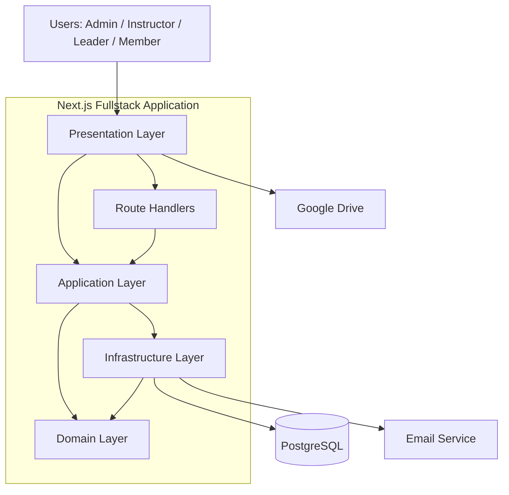
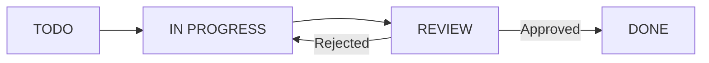
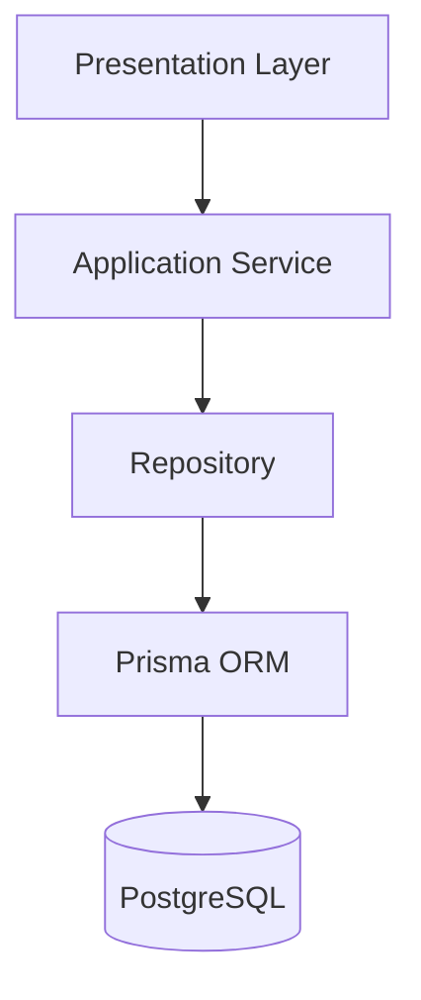
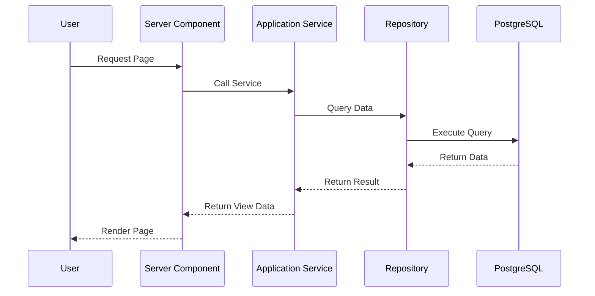
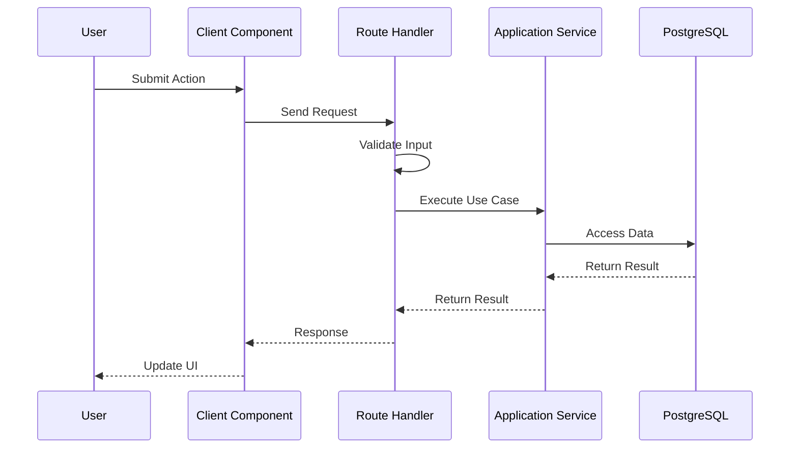
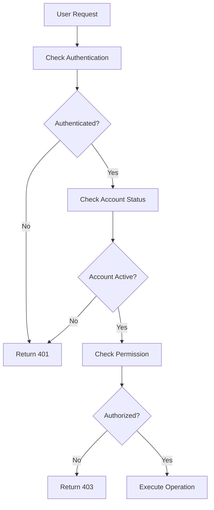
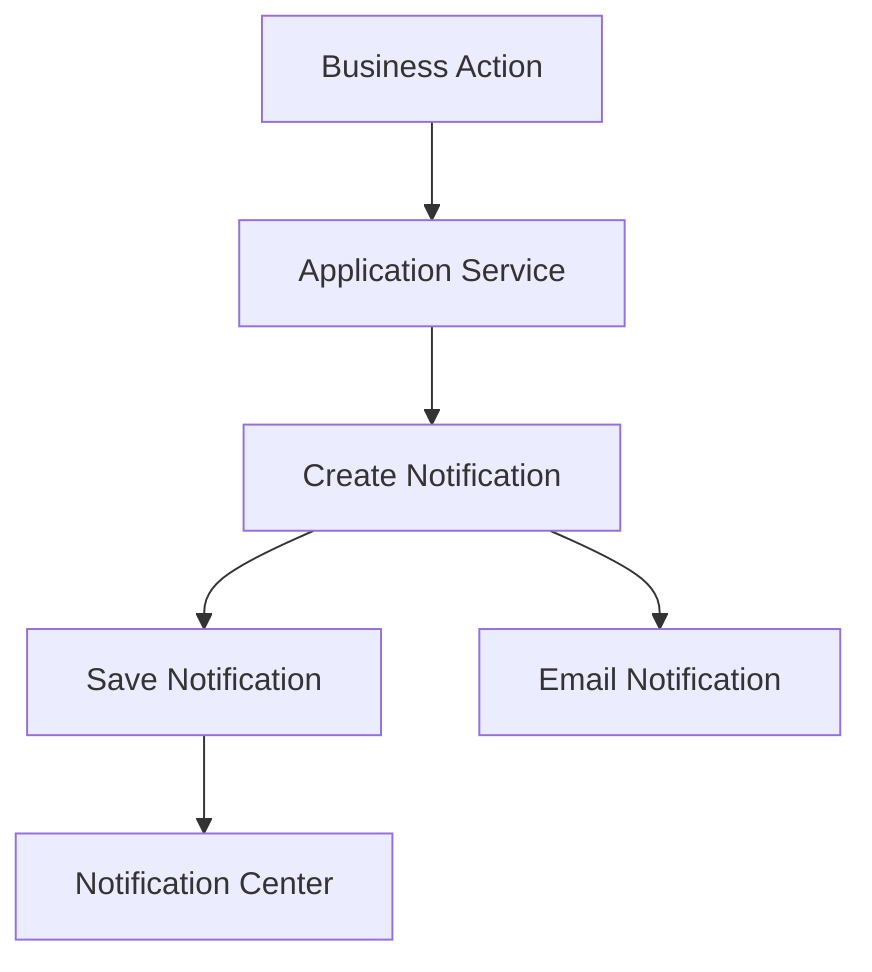
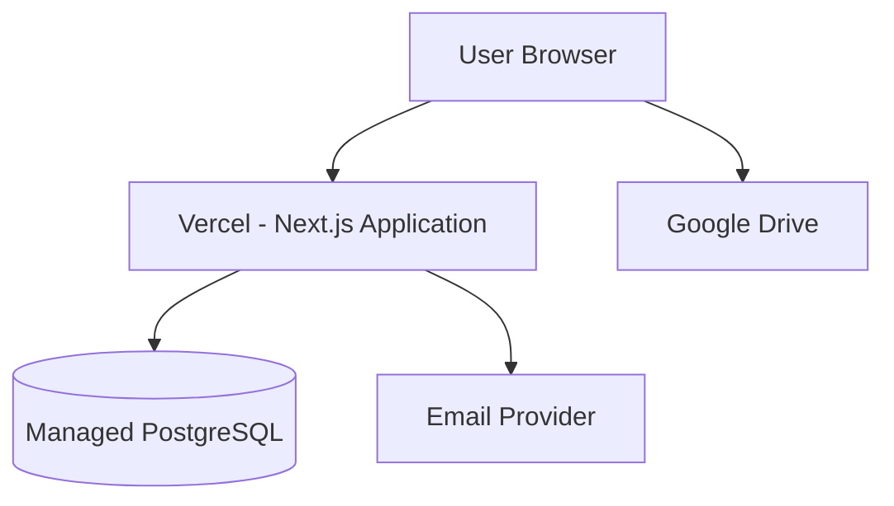

# SOFTWARE ARCHITECTURE DOCUMENT (SAD)

**Project:** Akatsuki Yui  
**Document Version:** 1.0  
**Status:** Draft  
**Last Updated:** 14/11/2026

---

# 1. Introduction

## 1.1. Purpose

Tài liệu Software Architecture Document (SAD) mô tả kiến trúc tổng thể của hệ thống Akatsuki Yui, bao gồm kiến trúc phần mềm, cấu trúc các thành phần, cách tổ chức mã nguồn, luồng xử lý dữ liệu, bảo mật và phương thức triển khai.

Mục tiêu của tài liệu:

- Xác định kiến trúc phù hợp với phạm vi MVP.
- Định nghĩa ranh giới giữa các module.
- Đảm bảo hệ thống dễ phát triển, kiểm thử và bảo trì.
- Hạn chế sự phụ thuộc không cần thiết giữa các thành phần.
- Tạo cơ sở thống nhất cho quá trình triển khai.

## 1.2. Scope

Tài liệu tập trung vào kiến trúc kỹ thuật của các module:

1. Authentication & Account Management.
2. Authorization & Permission Management.
3. Project Management.
4. Member Management.
5. Task Management.
6. Sprint Management.
7. Kanban Board.
8. Document Library.
9. Notification Management.
10. Dashboard & Reporting.
11. Activity & Audit Log.

## 1.3. Architecture Goals

- Đơn giản, phù hợp với quy mô một nhóm sinh viên.
- Ưu tiên kiến trúc Modular Monolith.
- Sử dụng Next.js Fullstack, không triển khai Backend riêng bằng NestJS hoặc Express.
- Tách biệt giao diện, nghiệp vụ và truy cập dữ liệu.
- Đảm bảo xác thực và phân quyền ở phía Server.
- Có thể mở rộng module mà không cần thay đổi toàn bộ hệ thống.
- Ưu tiên các dịch vụ có Free Tier phù hợp.

---

# 2. Architecture Overview

## 2.1. Architecture Style

Hệ thống sử dụng **Modular Monolith Architecture**.

Toàn bộ ứng dụng được triển khai như một ứng dụng Next.js thống nhất, nhưng mã nguồn được chia thành các module nghiệp vụ có ranh giới rõ ràng.

Mỗi module chịu trách nhiệm cho một nhóm chức năng cụ thể và hạn chế truy cập trực tiếp vào nội bộ của module khác.

### Lý do lựa chọn

- Quy mô hệ thống và số lượng người dùng không yêu cầu Microservices.
- Giảm độ phức tạp trong triển khai và vận hành.
- Dễ phát triển, debug và kiểm thử.
- Có thể quản lý nghiệp vụ tập trung.
- Phù hợp với Next.js Fullstack.

## 2.2. High-Level Architecture

Hệ thống được chia thành các lớp chính:

1. Presentation Layer.
2. Application Layer.
3. Domain Layer.
4. Infrastructure Layer.
5. Database Layer.
6. External Services.

### Architecture Diagram



**Lưu ý:** Đây là sơ đồ kiến trúc logic. Không phải mọi thao tác đều phải đi qua Route Handler. Server Components có thể gọi trực tiếp Application Layer để lấy dữ liệu.

## 2.3. Architectural Principles

| Principle | Description |
|---|---|
| Separation of Concerns | Tách biệt giao diện, nghiệp vụ và truy cập dữ liệu |
| Modular Design | Chia hệ thống thành các module độc lập về nghiệp vụ |
| Single Responsibility | Mỗi thành phần có một trách nhiệm chính |
| Server-side Security | Xác thực và phân quyền ở phía Server |
| Data Integrity | Bảo vệ tính nhất quán của dữ liệu |
| Reusability | Tái sử dụng các thành phần và logic chung |
| Simplicity | Không sử dụng công nghệ phức tạp khi chưa cần thiết |

---

# 3. Technology Stack

Các công nghệ dưới đây là phương án đề xuất cho MVP. Những lựa chọn chưa được xác nhận chính thức sẽ được chốt trong quá trình thiết lập dự án.

| Category | Proposed Technology | Purpose |
|---|---|---|
| Framework | Next.js | Fullstack Web Application |
| Language | TypeScript | Static Type Checking |
| UI Library | React | User Interface |
| Styling | Tailwind CSS | Styling |
| UI Components | shadcn/ui | Reusable UI Components |
| Database | PostgreSQL | Relational Database |
| ORM | Prisma | Database Access |
| Validation | Zod | Input Validation |
| Form Management | React Hook Form | Form Handling |
| Charts | Recharts | Dashboard & Reports |
| Authentication | Auth.js hoặc giải pháp Session-based phù hợp | Authentication |
| Version Control | Git & GitHub | Source Code Management |
| Deployment | Vercel | Application Hosting |
| Database Hosting | Neon hoặc Supabase | PostgreSQL Hosting |
| Email | Dịch vụ Email có Free Tier | Email Notifications |

**Technology Selection Notes:**

- Không sử dụng đồng thời nhiều ORM.
- Không truy cập Database trực tiếp từ Client.
- Không triển khai Backend riêng trong MVP.
- Cần kiểm tra giới hạn Free Tier trước khi quyết định nền tảng Hosting.
- Phiên bản thư viện cần được xác định trong quá trình khởi tạo dự án.

---

# 4. System Modules

## 4.1. Authentication & Account Management

**Responsibilities:**

- Đăng ký tài khoản.
- Đăng nhập và đăng xuất.
- Quản lý thông tin tài khoản.
- Quản lý trạng thái tài khoản.
- Phê duyệt hoặc từ chối tài khoản đăng ký.
- Quản lý hồ sơ người dùng.

**Main Components:**

- Authentication Service.
- Account Service.
- Registration Service.
- Session Management.

## 4.2. Authorization & Permission Management

**Responsibilities:**

- Quản lý Role.
- Quản lý Permission.
- Kiểm tra quyền truy cập.
- Áp dụng quyền theo phạm vi hệ thống hoặc Project.
- Ghi nhận thay đổi quyền.

**Roles:**

- Admin.
- Instructor.
- Leader.
- Member.

Authorization phải được kiểm tra ở phía Server, không chỉ dựa vào việc ẩn hoặc hiện các thành phần trên giao diện.

## 4.3. Project Management

**Responsibilities:**

- Tạo Project.
- Cập nhật thông tin Project.
- Quản lý Project Members.
- Quản lý trạng thái Project.
- Kích hoạt hoặc lưu trữ Project.
- Quản lý Project Template.

**Business Constraints:**

- Chỉ có một Project ở trạng thái Active tại một thời điểm.
- Project đã Archived vẫn được lưu giữ dữ liệu và lịch sử.
- Project có thể sử dụng Project Template; Template là tùy chọn.

## 4.4. Task Management

**Responsibilities:**

- Tạo và cập nhật Task.
- Quản lý Assignees.
- Quản lý Priority.
- Quản lý Estimate.
- Quản lý Deadline.
- Quản lý Task Dependency.
- Xử lý quy trình Review.
- Lưu Task History.

**Task Workflow:**



Mỗi Task có một trạng thái chung, kể cả khi được giao cho nhiều Assignees.

Việc duyệt hoặc từ chối Task phải được thực hiện bởi người có quyền phù hợp. Lý do xử lý Review phải được lưu vào lịch sử Task.

## 4.5. Sprint Management

**Responsibilities:**

- Tạo Sprint.
- Cập nhật Sprint.
- Quản lý Sprint Goal.
- Quản lý Start Date và End Date.
- Quản lý Sprint Status.
- Chuyển Task từ Backlog vào Sprint.
- Theo dõi tiến độ Sprint.

**Business Constraints:**

- Sprint thuộc về một Project.
- Task chỉ thuộc Backlog hoặc một Sprint tại một thời điểm.
- Task không được thuộc nhiều Sprint cùng lúc.
- Sprint có thời gian bắt đầu và kết thúc xác định.

## 4.6. Kanban Board

**Responsibilities:**

- Hiển thị Task theo trạng thái.
- Hỗ trợ lọc Task.
- Hiển thị Backlog.
- Hiển thị Task thuộc Sprint.
- Theo dõi tiến độ công việc.

**Filters:**

- Sprint.
- Assignee.
- Priority.
- Deadline.
- Status.

Kanban Board sử dụng dữ liệu từ Task Management và Sprint Management, không quản lý một bản dữ liệu Task riêng.

## 4.7. Document Library

**Responsibilities:**

- Tạo Document Record.
- Cập nhật thông tin tài liệu.
- Phân loại tài liệu.
- Liên kết tài liệu với Project.
- Liên kết tài liệu với Sprint nếu cần.
- Mở tài liệu thông qua Google Drive URL.

**Document Categories:**

- Project Documents.
- Design.
- Development.
- Meeting & Reports.
- Other.

Hệ thống chỉ lưu thông tin và đường dẫn Google Drive, không lưu trữ hoặc tải lên file trực tiếp.

## 4.8. Notification Management

**Responsibilities:**

- Tạo thông báo.
- Hiển thị Notification Center.
- Quản lý trạng thái Read/Unread.
- Gửi Email Notification.
- Lưu lịch sử gửi thông báo.

**Notification Channels:**

- In-app Notification.
- Email Notification.

Notification được tạo từ các sự kiện nghiệp vụ như:

- Task được giao.
- Member gửi Task sang Review.
- Leader phê duyệt Task.
- Leader từ chối Task Review.

## 4.9. Dashboard & Reporting

**Responsibilities:**

- Tổng hợp số lượng Task.
- Hiển thị Task hoàn thành.
- Hiển thị Task quá hạn.
- Hiển thị Task đang chờ Review.
- Theo dõi tiến độ Sprint.
- Hiển thị Burndown Chart.
- Theo dõi tiến độ và đóng góp của thành viên.

Dữ liệu báo cáo phải dựa trên các bản ghi nghiệp vụ và lịch sử thực tế. Không sử dụng số lượng Task đơn thuần để kết luận chất lượng hoặc năng suất của một thành viên.

## 4.10. Activity & Audit Log

**Responsibilities:**

- Ghi nhận các hoạt động quan trọng.
- Lưu lịch sử thay đổi Task.
- Lưu lịch sử phân công.
- Lưu lịch sử Review.
- Lưu lịch sử thay đổi quyền.
- Hỗ trợ truy xuất lịch sử khi cần.

---

# 5. Application Layer Design

## 5.1. Presentation Layer

Chịu trách nhiệm hiển thị giao diện và tiếp nhận tương tác từ người dùng.

**Responsibilities:**

- Render UI.
- Hiển thị dữ liệu.
- Tiếp nhận thao tác.
- Kiểm tra dữ liệu ở mức giao diện.
- Gửi yêu cầu xử lý nghiệp vụ.
- Hiển thị kết quả và thông báo lỗi.

Presentation Layer không được chứa các nghiệp vụ quan trọng hoặc truy cập Database trực tiếp.

## 5.2. Application Layer

Chịu trách nhiệm điều phối các Use Case.

**Responsibilities:**

- Nhận yêu cầu từ Presentation Layer hoặc Route Handler.
- Kiểm tra quyền truy cập.
- Gọi Domain Logic.
- Gọi Repository để truy xuất dữ liệu.
- Quản lý Transaction khi cần.
- Điều phối Notification và Audit Log.
- Trả kết quả cho lớp gọi.

Ví dụ:

- CreateProject.
- AssignTask.
- SubmitTaskForReview.
- ApproveTaskReview.
- RejectTaskReview.
- CreateSprint.
- PlanSprint.

## 5.3. Domain Layer

Chứa các quy tắc nghiệp vụ cốt lõi.

**Responsibilities:**

- Định nghĩa Business Rules.
- Kiểm tra điều kiện chuyển trạng thái.
- Kiểm tra quy tắc phân công.
- Kiểm tra quy tắc Sprint.
- Kiểm tra Task Dependency.
- Đảm bảo tính hợp lệ của các thao tác nghiệp vụ.

Domain Layer không phụ thuộc vào giao diện hoặc thư viện Database cụ thể.

## 5.4. Infrastructure Layer

Chịu trách nhiệm kết nối với các công nghệ và dịch vụ bên ngoài.

**Responsibilities:**

- Prisma Database Access.
- Email Provider Integration.
- Logging.
- External Service Integration.
- Các triển khai kỹ thuật của Repository.

Infrastructure Layer không được tự ý thay đổi Business Rules.

---

# 6. Proposed Project Structure

Cấu trúc thư mục đề xuất:

```text
akatsuki-yui/
│
├── prisma/
│   ├── schema.prisma
│   ├── migrations/
│   └── seed.ts
│
├── public/
│   ├── images/
│   └── icons/
│
├── src/
│   │
│   ├── app/
│   │   ├── (auth)/
│   │   │   ├── login/
│   │   │   └── register/
│   │   │
│   │   ├── (dashboard)/
│   │   │   ├── dashboard/
│   │   │   ├── projects/
│   │   │   ├── tasks/
│   │   │   ├── sprints/
│   │   │   ├── documents/
│   │   │   ├── notifications/
│   │   │   ├── reports/
│   │   │   └── settings/
│   │   │
│   │   ├── api/
│   │   │   └── ...
│   │   │
│   │   ├── layout.tsx
│   │   └── page.tsx
│   │
│   ├── components/
│   │   ├── ui/
│   │   ├── layout/
│   │   └── shared/
│   │
│   ├── modules/
│   │   ├── auth/
│   │   ├── users/
│   │   ├── authorization/
│   │   ├── projects/
│   │   ├── tasks/
│   │   ├── sprints/
│   │   ├── documents/
│   │   ├── notifications/
│   │   ├── dashboard/
│   │   └── activity/
│   │
│   ├── lib/
│   │   ├── prisma.ts
│   │   ├── auth.ts
│   │   ├── env.ts
│   │   └── utils.ts
│   │
│   ├── server/
│   │   ├── services/
│   │   ├── repositories/
│   │   ├── policies/
│   │   └── integrations/
│   │
│   ├── types/
│   │
│   └── middleware.ts
│
├── tests/
│   ├── unit/
│   ├── integration/
│   └── e2e/
│
├── docs/
│
├── .env.example
├── .gitignore
├── package.json
├── tsconfig.json
└── README.md
```

**Folder Organization Notes:**

- `app/`: Next.js routes, layouts và Route Handlers.
- `components/`: UI components dùng chung.
- `modules/`: Thành phần theo từng module nghiệp vụ.
- `server/`: Các thành phần chỉ chạy phía Server.
- `lib/`: Các tiện ích và cấu hình dùng chung.
- `prisma/`: Database Schema, Migration và Seed.
- `tests/`: Các loại kiểm thử.

Cấu trúc trên là cấu trúc đề xuất ban đầu. Khi triển khai, có thể đặt Service, Repository, Schema và các thành phần liên quan bên trong từng module để tăng tính độc lập. Cần tránh tạo hai nơi chứa cùng một loại logic.

---

# 7. Data Access Architecture

## 7.1. Database Access

Hệ thống sử dụng PostgreSQL làm Database quan hệ và Prisma làm ORM.

Luồng truy cập dữ liệu:



## 7.2. Data Access Rules

- Chỉ Server được phép truy cập Database.
- Không sử dụng Prisma trong Client Components.
- Không gửi Database Credentials đến trình duyệt.
- Không để Presentation Layer truy vấn Database trực tiếp.
- Các thao tác dữ liệu quan trọng phải thông qua Application Service.
- Sử dụng Transaction khi một nghiệp vụ cần cập nhật nhiều bản ghi liên quan.

## 7.3. Repository Pattern

Repository chịu trách nhiệm đóng gói các thao tác truy xuất dữ liệu.

Ví dụ:

- UserRepository.
- ProjectRepository.
- TaskRepository.
- SprintRepository.
- DocumentRepository.
- NotificationRepository.

Không bắt buộc phải tạo Repository cho mọi bảng. Chỉ sử dụng khi giúp tách biệt truy cập dữ liệu và nghiệp vụ một cách rõ ràng.

## 7.4. Data Integrity

Các ràng buộc dữ liệu cần được bảo vệ ở nhiều cấp độ:

- Database Constraints.
- Foreign Keys.
- Unique Constraints.
- Input Validation.
- Business Rules.
- Database Transactions.

Các nghiệp vụ quan trọng như kích hoạt Project, phân công Task, xử lý Review và lập Sprint cần đảm bảo dữ liệu không rơi vào trạng thái không hợp lệ khi có lỗi xảy ra.

---

# 8. Request & Data Flow

## 8.1. Server Component Flow

Đối với các trang chủ yếu hiển thị dữ liệu:



Server Components nên gọi trực tiếp Application Service thay vì gửi HTTP Request đến API nội bộ của chính ứng dụng.

## 8.2. Client Interaction Flow

Đối với các thao tác từ Client:



Có thể sử dụng Server Actions cho các thao tác phù hợp. Dù sử dụng Server Actions hay Route Handlers, việc xác thực, phân quyền và kiểm tra dữ liệu vẫn phải được thực hiện ở phía Server.

---

# 9. Authentication & Authorization Architecture

## 9.1. Authentication

Authentication xác định danh tính người dùng.

Các chức năng chính:

- Register.
- Login.
- Logout.
- Session Management.
- Account Status Validation.

Tài khoản chỉ được phép truy cập các chức năng được bảo vệ khi đã đăng nhập và có trạng thái phù hợp.

## 9.2. Authorization

Authorization xác định người dùng được phép thực hiện hành động nào.

Hệ thống sử dụng Role-Based Access Control (RBAC), kết hợp với phạm vi tài nguyên khi cần.

Ví dụ:

| Role | General Permission |
|---|---|
| Admin | Quản lý toàn bộ hệ thống |
| Instructor | Theo dõi Project và tiến độ |
| Leader | Quản lý Project, Task, Sprint và Review |
| Member | Xem và cập nhật công việc được giao |

## 9.3. Authorization Flow



## 9.4. Security Rules

- Mật khẩu phải được hash bằng thuật toán phù hợp.
- Không lưu mật khẩu dạng văn bản thuần.
- Session Cookie cần sử dụng các thuộc tính bảo mật phù hợp.
- Kiểm tra quyền ở phía Server cho mọi thao tác được bảo vệ.
- Không tin tưởng Role hoặc Permission do Client gửi lên.
- Kiểm tra quyền truy cập Project và tài nguyên liên quan.
- Ghi nhận các thay đổi quyền quan trọng.
- Không cho phép xóa hoặc vô hiệu hóa quyền quản trị của Admin cuối cùng.

---

# 10. External Integrations

## 10.1. Google Drive

Google Drive được sử dụng làm nơi lưu trữ tài liệu.

Hệ thống:

- Lưu URL tài liệu.
- Lưu tên tài liệu.
- Lưu danh mục.
- Liên kết tài liệu với Project hoặc Sprint.
- Mở URL trong tab mới.

MVP không yêu cầu Google Drive API hoặc đồng bộ dữ liệu tự động.

## 10.2. Email Service

Email Service được sử dụng để gửi thông báo đến người dùng.

Các sự kiện có thể gửi Email:

- Tài khoản được phê duyệt hoặc từ chối.
- Task được giao.
- Task được gửi sang Review.
- Task được phê duyệt hoặc từ chối Review.

Email Provider cụ thể: **[CHƯA XÁC ĐỊNH]**. Việc gửi Email Notification là bắt buộc trong MVP; chỉ nhà cung cấp còn chờ lựa chọn. Email Notification vẫn là yêu cầu bắt buộc của MVP; chỉ nhà cung cấp là chưa được chọn.

## 10.3. GitHub

MVP chỉ lưu Repository URL trong Project.

Không triển khai:

- GitHub OAuth Integration.
- Webhook.
- Commit Tracking.
- Pull Request Tracking.
- Issue Synchronization.

---

# 11. Notification Architecture

Notification được tạo từ các sự kiện nghiệp vụ.

Ví dụ:



## 11.1. Notification Rules

- Notification phải xác định được người nhận.
- Notification phải lưu loại sự kiện.
- Notification phải lưu thời điểm tạo.
- Notification có trạng thái Read/Unread.
- Lịch sử gửi Email cần được ghi nhận.
- Lỗi gửi Email không được làm mất dữ liệu nghiệp vụ đã xử lý thành công.

## 11.2. Delivery Strategy

Email Notification phải được triển khai trong MVP. Có thể chọn gửi trực tiếp hoặc xử lý nền đơn giản theo giới hạn Hosting, nhưng phải lưu trạng thái gửi và có cơ chế retry phù hợp.

Cần đảm bảo việc gửi lại Email không tạo ra thông báo trùng lặp ngoài ý muốn.

Cơ chế xử lý nền và Retry nâng cao: **[CHƯA XÁC ĐỊNH]**.

---

# 12. Security Architecture

## 12.1. Security Requirements

| Area | Requirement |
|---|---|
| Authentication | Xác thực người dùng trước khi truy cập chức năng được bảo vệ |
| Password | Hash mật khẩu |
| Session | Sử dụng Cookie bảo mật |
| Authorization | Kiểm tra quyền ở Server |
| Validation | Kiểm tra dữ liệu đầu vào |
| Database | Không để Client truy cập trực tiếp |
| Environment | Không đưa Secret lên GitHub |
| Error Handling | Không tiết lộ thông tin nội bộ |
| Audit | Ghi nhận các hoạt động quan trọng |
| Project Isolation | Kiểm tra quyền truy cập tài nguyên thuộc Project |

## 12.2. Input Validation

Sử dụng Zod hoặc giải pháp tương đương để kiểm tra:

- Required Fields.
- Data Types.
- String Length.
- Date Range.
- URL Format.
- Numeric Range.
- Business Constraints.

Validation phải được thực hiện ở Server ngay cả khi giao diện đã có kiểm tra dữ liệu.

## 12.3. Sensitive Data

Không ghi các thông tin nhạy cảm vào Log, bao gồm:

- Password.
- Session Token.
- Authentication Secret.
- Database Credentials.
- Các thông tin bảo mật khác.

---

# 13. Error Handling & Logging

## 13.1. Error Handling

Hệ thống cần xử lý các trường hợp:

- Authentication Failed.
- Permission Denied.
- Invalid Input.
- Resource Not Found.
- Business Rule Violation.
- Database Error.
- External Service Error.
- Unexpected Server Error.

Lỗi cần được xử lý và trả về thông báo phù hợp với người dùng.

Không hiển thị Stack Trace hoặc thông tin kỹ thuật nhạy cảm trên giao diện.

## 13.2. Logging

Log cần hỗ trợ:

- Theo dõi lỗi.
- Debug các vấn đề phát sinh.
- Theo dõi các thao tác quan trọng.
- Kiểm tra hoạt động của Email Integration.

Phân biệt:

- Application Logs: phục vụ kỹ thuật và debug.
- Activity Logs: phục vụ theo dõi hoạt động người dùng.
- Audit Logs: phục vụ truy vết thay đổi quan trọng.

---

# 14. Performance & Scalability

## 14.1. Performance Considerations

- Sử dụng Pagination cho danh sách dữ liệu lớn.
- Chỉ truy vấn các trường cần thiết.
- Tránh N+1 Query.
- Sử dụng Index cho các trường thường xuyên tìm kiếm hoặc lọc.
- Tối ưu các truy vấn Dashboard.
- Tránh tải toàn bộ Task khi chỉ cần dữ liệu của một Sprint.
- Sử dụng cơ chế Cache phù hợp khi thực sự cần thiết.

## 14.2. Scalability

Kiến trúc Modular Monolith cho phép mở rộng hệ thống theo hướng:

- Bổ sung module nghiệp vụ.
- Tối ưu từng module.
- Tách các tác vụ nền khi cần.
- Chuyển đổi một module thành dịch vụ độc lập trong tương lai nếu có lý do thực tế.

Việc chuyển sang Microservices không nằm trong phạm vi MVP.

---

# 15. Testing Architecture

## 15.1. Unit Testing

Kiểm thử các thành phần nghiệp vụ độc lập:

- Task Status Transition.
- Permission Checking.
- Sprint Planning Rules.
- Project Lifecycle.
- Task Assignment Rules.
- Review Decision Rules.

## 15.2. Integration Testing

Kiểm thử sự phối hợp giữa:

- Application Service và Repository.
- Repository và Database.
- Authentication và Authorization.
- Task và Notification.
- Sprint và Task.
- Project và Project Members.

## 15.3. End-to-End Testing

Kiểm thử các luồng nghiệp vụ chính:

1. Register Account → Admin Approval → Login.
2. Create Project → Add Members.
3. Create Task → Assign Members.
4. Submit Task for Review → Approve/Reject.
5. Create Sprint → Plan Sprint → Track Progress.
6. Create Document Record → Open Google Drive URL.
7. Trigger Notification → View Notification.
8. View Dashboard → View Reports.

---

# 16. Deployment Architecture

## 16.1. Deployment Overview

Mô hình triển khai đề xuất:



## 16.2. Deployment Components

| Component | Proposed Platform |
|---|---|
| Web Application | Vercel |
| Database | Neon hoặc Supabase |
| Source Code | GitHub |
| Document Storage | Google Drive |
| Email | Free-tier Email Provider |

Các nền tảng trên là lựa chọn đề xuất, chưa phải quyết định triển khai cuối cùng.

## 16.3. Environment Configuration

Các biến môi trường dự kiến:

```env
DATABASE_URL=
AUTH_SECRET=
APP_URL=

EMAIL_HOST=
EMAIL_PORT=
EMAIL_USER=
EMAIL_PASSWORD=
EMAIL_FROM=
```

Không commit file `.env` chứa Secret lên GitHub.

Cần cung cấp `.env.example` với tên biến và giá trị mẫu không nhạy cảm.

## 16.4. Deployment Requirements

- Ứng dụng phải build thành công.
- Database Migration phải được kiểm tra trước khi triển khai.
- Production Environment phải sử dụng Secret riêng.
- Kiểm tra kết nối Database sau khi triển khai.
- Kiểm tra Authentication và Authorization.
- Kiểm tra các luồng nghiệp vụ chính.
- Có phương án khôi phục dữ liệu phù hợp với khả năng của nền tảng Hosting.

---

# 17. Architecture Decision Records (ADR)

Các quyết định kiến trúc quan trọng:

| ID | Decision | Reason | Status |
|---|---|---|---|
| ADR-001 | Modular Monolith | Phù hợp quy mô MVP | Accepted |
| ADR-002 | Next.js Fullstack | Không cần Backend riêng | Accepted |
| ADR-003 | PostgreSQL | Phù hợp dữ liệu quan hệ | Proposed |
| ADR-004 | Prisma ORM | Quản lý Database Schema và Query | Proposed |
| ADR-005 | Server-side Authorization | Bảo vệ tài nguyên và nghiệp vụ | Accepted |
| ADR-006 | Google Drive URL | Không cần xây dựng File Storage | Accepted |
| ADR-007 | GitHub URL Only | Giảm phạm vi tích hợp | Accepted |
| ADR-008 | Managed Hosting | Giảm chi phí vận hành | Proposed |

---

# 18. Unresolved Architecture Decisions

Các nội dung chưa được xác định chính thức:

| ID | Decision | Current Status |
|---|---|---|
| SAD-001 | Authentication Library | Đã chốt (`DEC-012`): Auth.js (NextAuth v5) Credentials + JWT HTTP-only cookie |
| SAD-002 | Database Hosting | Chưa chọn Neon hay Supabase |
| SAD-003 | Email Provider | Đã chốt (`DEC-016`): Resend (Free Tier API) |
| SAD-004 | Background Email Processing | Đã chốt (`DEC-016`): `NotificationDelivery` (`PENDING/SENT/FAILED`) + retry tối đa 3 lần |
| SAD-005 | Cache Strategy | Chưa cần thiết cho MVP |
| SAD-006 | Logging Provider | Chưa chọn |
| SAD-007 | Testing Framework | Chưa chọn |
| SAD-008 | Deployment Environment | Chưa chốt cấu hình cuối cùng |

Các quyết định này sẽ được cập nhật khi bắt đầu triển khai kỹ thuật.

---

# 19. Architecture Constraints

- Không triển khai Microservices trong MVP.
- Không sử dụng NestJS hoặc Express làm Backend riêng.
- Không yêu cầu Docker hoặc Kubernetes.
- Không truy cập Database trực tiếp từ Client.
- Không lưu file tài liệu trực tiếp trên hệ thống.
- Không tích hợp GitHub API trong MVP.
- Không triển khai Chat hoặc Realtime Collaboration nâng cao.
- Ưu tiên các dịch vụ miễn phí.
- Không xây dựng kiến trúc phức tạp vượt quá nhu cầu thực tế.

---

# 20. Conclusion

Akatsuki Yui sử dụng kiến trúc Modular Monolith dựa trên Next.js Fullstack nhằm đảm bảo sự đơn giản, dễ phát triển và phù hợp với phạm vi MVP.

Hệ thống được tổ chức theo các module nghiệp vụ, kết hợp với việc phân chia Presentation, Application, Domain và Infrastructure Layer.

Kiến trúc này giúp duy trì ranh giới trách nhiệm rõ ràng, hỗ trợ kiểm soát quyền truy cập, bảo vệ dữ liệu và tạo điều kiện mở rộng hệ thống trong tương lai mà không cần triển khai Microservices ngay từ đầu.

---

# 21. Document Change History

| Version | Date | Description |
|---|---|---|
| 1.0 | 14/11/2026 | Initial Architecture Document |


## Decision Alignment — 2026-11-14

- Project Template và Instructor là tùy chọn; persistence model phải cho phép NULL tương ứng.
- Task Priority: `LOW`, `MEDIUM`, `HIGH`, `CRITICAL`.
- Estimate dùng Time-based Hours trong MVP.
- Domain/Application layer phải chặn transition sang `DONE` nếu predecessor Task chưa `DONE`; kiểm tra ở Server, không dựa vào UI.
- Cho phép nhiều Sprint `ACTIVE` trong cùng Project; không áp dụng invariant chỉ một Active Sprint.
- Kết thúc Sprint không tự động chuyển Task chưa hoàn thành; Leader quyết định từng Task và thao tác phải lưu lịch sử.
- Restore Project là thao tác Admin-only và phải kiểm tra single-active-Project constraint nếu khôi phục sang `ACTIVE`.
- Remove Project Member phải kiểm tra và yêu cầu reassign toàn bộ Task đang giao trước khi xóa membership.
- Email Notification là Must Have của MVP; Email Provider là quyết định kỹ thuật còn mở.


## Confirmed Architecture Decisions — 2026-11-14

- Project Template và Instructor là dữ liệu tùy chọn; Application Layer và Database phải chấp nhận NULL tương ứng.
- Task Priority Enum là LOW/MEDIUM/HIGH/CRITICAL.
- Task Estimate dùng giờ.
- Application Service xử lý Task Dependency và từ chối chuyển DONE nếu predecessor chưa DONE; kiểm tra trong transaction để tránh race condition.
- Nhiều Sprint ACTIVE trên cùng Project được phép; không áp đặt unique constraint một Active Sprint/Project.
- Project Restore là use case Admin-only, cần transaction và kiểm tra single ACTIVE Project.
- Remove Member phải kiểm tra và yêu cầu reassign toàn bộ Task trước khi xóa membership.
- Email Notification là tích hợp bắt buộc trong MVP. Nên dùng NotificationDelivery/Outbox-like persistence và retry có kiểm soát; không rollback nghiệp vụ chính khi provider tạm lỗi.
